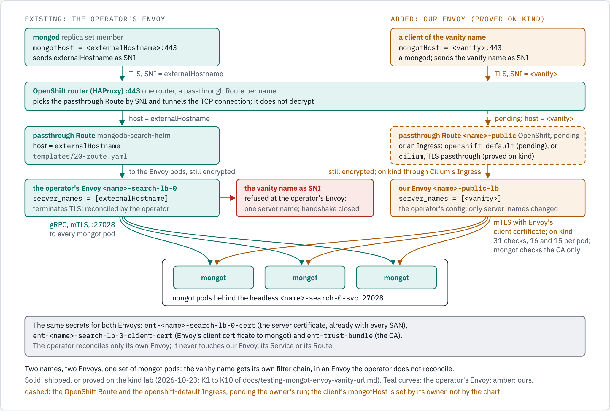

# mongot-envoy-vanity-url-helm

A second Envoy for a vanity hostname (a name the company's DNS points at the OpenShift router) in front of the
mongot pods that [mongodb-search-helm](../mongodb-search-helm/README.md) runs, beside the operator's Envoy, which
this chart never touches. The install on OpenShift, step by step, and the proof of which path the traffic takes are
in [`docs/mongot-envoy-vanity-url.md`](../../docs/mongot-envoy-vanity-url.md); this page is the chart's reference
and travels with the package.

<!-- markdownlint-disable MD033 -->

<!-- markdownlint-enable MD033 -->

## What it is for

The operator (MongoDB Kubernetes operator 1.13.0) builds its Envoy's listener with a single filter chain whose match
is the MongoDBSearch's `externalHostname` and nothing else. Read from the running pod
([`docs/envoy/lds.json`](../../docs/envoy/lds.json), lines 12 to 18):

```json
"filter_chains": [
    {
        "filter_chain_match": {
            "server_names": [
                "grpc-search.apps-crc.testing"
            ]
        },
```

`tls_inspector` reads the SNI of every ClientHello before decryption and the chain is chosen by it; no SNI, or a
different one, matches no chain and the connection is closed ([`ENVOY-FLOW.md`](../../ENVOY-FLOW.md), steps 2 and
3). The route's `domains: ["*"]` matches any `:authority`, so the SNI is the only host gate. What a client dialling
another name sees was measured on the lab with `vip-grpc-search.apps-crc.testing`, a spare SAN of the certificate,
as `mongotHost` (main [README, "What a wrong SNI does, by path"](../../README.md#what-a-wrong-sni-does-by-path)):

```text
:27028  SNI vip-grpc-search...  -> Envoy closes the handshake, serves NO certificate
                                   ("unexpected eof while reading")

:443    SNI vip-grpc-search...  -> the router's DEFAULT certificate (CN=*.apps-crc.testing)
                                   and NO ALPN. TLS "succeeds" and never reaches Envoy.
```

The second case is the one on OpenShift: a passthrough Route is only taken when the SNI is in the router's
`os_sni_passthrough.map`; any other name falls to the terminating flow (`be_sni`), which binds the router's default
certificate with `no-alpn`. A check that asserts "TLS connects" passes while no request reaches the search tier.

Two more facts close the other ways out: the operator reconciles its Envoy's ConfigMap and Deployment, so an edit to
`lds.json` is overwritten, and the MongoDBSearch has one `externalHostname`, so one name; and mongot checks that a
client certificate is signed by a trusted CA and does not check its name ([`TLS.md`](../../TLS.md), "Limits worth
designing around"), so an Envoy of our own that presents the same client certificate is, to mongot, the operator's
Envoy.

So this chart runs its own Envoy with the operator's own configuration ([`docs/envoy/`](../../docs/envoy/), read
from its running pod), changed in one place: the accepted server name is the vanity hostname. A client dialling it
sends it as SNI; the router's map now holds it (the chart's Route), the router forwards the stream to our Envoy,
whose chain matches it and presents the server certificate, which already carries the name as a SAN; the gRPC
streams are split over the mongot pods as before.

## What it does

| Order | Object | Name | What for |
| --- | --- | --- | --- |
| before anything | preflight Job | `<search.name>-public-preflight` | Fails the install when a secret or the trust bundle is missing or lacks a key, when the server certificate does not name a server name, or when the mongot Service does not exist |
| 0 | ConfigMap | `<search.name>-public-envoy` | Envoy's bootstrap: the operator's configuration as static resources |
| 1 | Deployment | `<search.name>-public-lb` | Envoy, 2 pods, readiness on its admin `/ready` |
| 1 | Service | `<search.name>-public-lb` | ClusterIP, port `mongot-grpc` 27028, this Deployment's pods only |
| 1 | PodDisruptionBudget | `<search.name>-public-lb` | A node drain takes one Envoy pod at a time |
| 2 | Route, or Ingress | `<search.name>-public` | Passthrough, host `vanityHostname`, `balance: roundrobin` |
| 0 | Service, ServiceMonitor | `<search.name>-public-envoy-stats`, `<search.name>-public-envoy` | Per-pod scraping of Envoy's admin port; off by default |

All in the MongoDBSearch's namespace, all named `<search.name>-public…`. It does not create a certificate, a secret,
the trust bundle, a MongoDBSearch, or anything of the operator's, and it does not change the MongoDBSearch, the
operator's Envoy and its Route, the mongot pods, the secrets or the trust bundle. Nothing of the operator's is read
or written by the chart's objects; the preflight reads the two secrets, the trust bundle and the mongot Service by
name (its Role names them) and nothing else. Uninstalling the release removes only what it made.

The preflight runs in the cluster, as the Job's own ServiceAccount, on Red Hat's public UBI 9 image: `curl` against
the API server with the pod's token (in a header file, on no command line), `python3` for the API's JSON, `openssl`
for the certificate's names; no `oc`, no pull secret. A SAN equal to the name counts, and so does a one-label
wildcard (`*.example.com` covers `a.example.com`, not `a.b.example.com`), as the main chart's prerequisites script
matches. It prints key names and the certificate's DNS names, never a key or the token.

## What the configuration keeps

Everything the operator sets is kept, value for value: the listener on 0.0.0.0:27028 with `tls_inspector`; TLS 1.3
only, ALPN `h2`, a client certificate required; the HTTP connection manager with the router filter, 1 MiB HTTP/2
windows, keepalive 60 s/10 s, `stream_idle_timeout` and `request_timeout` 300 s, the JSON access log; the route
`prefix: /, grpc: {}` with a 300 s timeout and the retry policy (`connect-failure,refused-stream,unavailable,reset,
resource-exhausted`, 2 retries, 60 s per try, `previous_hosts`, 3 host selection attempts); the cluster with circuit
breakers 1024/1024/1024/3, a 300 s upstream idle timeout, the same HTTP/2 options, the client certificate, the
Service name as SNI and TCP keepalive 3/10/3; the admin port 9901 with the four allowed paths; and
`global_downstream_max_connections: 50000`. The render test compares the chart's bootstrap with
[`docs/envoy/`](../../docs/envoy/) field by field and names the fields that may differ: `server_names`, and the
cluster's endpoint and SNI, which follow the release's namespace. The three files are read from the operator's pod
as [`ENVOY-FLOW.md`](../../ENVOY-FLOW.md), "Getting the config out of the pod", shows.

## Install

The main chart installed and serving in the namespace, with mutual TLS (its secrets are this chart's), and a server
certificate whose SANs hold the vanity hostname: the company issues it with every name, and the main chart's script
makes the secret from it (a one-label wildcard counts there as it does in the preflight):

```bash
bash chart/mongodb-search-helm/generate-mongodbsearch-prerequisites.sh --route <pem> --hostname <name> --target-namespace <namespace> --apply
```

```bash
helm install mongot-public chart/mongot-envoy-vanity-url-helm -n <namespace> \
  --set vanityHostname=mongot-search.example.com
```

The release's notes print where to read the preflight's verdict, the pods and the entry. Then, by hand: point DNS
for the hostname at the router, whose name the Route reports, and set `mongotHost=<hostname>:443` on the mongod
hosts, with the company CA trusted:

```bash
oc get route <search.name>-public -n <namespace> -o jsonpath='{.status.ingress[0].routerCanonicalHostname}{"\n"}'
```

With Argo CD: the preflight and its RBAC are PreSync hooks; the objects sync in waves 0 to 2. The chart's own
objects are all namespaced; there is no ClusterRole.

## Values

| Value | Default | What |
| --- | --- | --- |
| `namespace` | empty: the namespace given with `-n` | Where every object goes: the MongoDBSearch's, which holds the secrets and the mongot Service |
| `search.name` | `mongot` | The MongoDBSearch's name; every name of this chart, of the secrets and of the mongot Service derives from it |
| `vanityHostname` | required | The vanity hostname: the Route's host and the TLS server name Envoy accepts. A DNS name of two labels or more, never an IP |
| `serverNames` | `[]`: `[vanityHostname]` | Every server name Envoy accepts, when one release serves more names; it must hold `vanityHostname`, each name once, and each must be a SAN of the server certificate |
| `tls.certsSecretPrefix` | `ent` | The main chart's prefix: the two secrets below derive from it |
| `tls.serverCertSecret` | empty: `<prefix>-<search.name>-search-lb-0-cert` | The server certificate Envoy presents to mongod |
| `tls.clientCertSecret` | empty: `<prefix>-<search.name>-search-lb-0-client-cert` | The client certificate Envoy presents to mongot |
| `tls.trustBundleConfigMap` | `ent-trust-bundle` | The ConfigMap with `ca.crt`, trusted on both legs |
| `mongot.service` | empty: `<search.name>-search-0-svc` | The headless mongot Service Envoy resolves to one host per pod |
| `mongot.port` | `27028` | mongot's gRPC port, and the port Envoy listens on |
| `envoy.image` | `quay.io/ephico2real/envoy:v1.37-latest` | The main chart's Envoy image: a copy of the operator's `envoyproxy/envoy:v1.37-latest`. A mutable tag (1.37.6 on 2026-10-22, digest `sha256:ea33a83e…`): record the resolved digest at deployment, or pin one here |
| `envoy.runAsUser` | empty | The uid and gid Envoy runs as. Empty on OpenShift, which assigns one; `101` (the image's `envoy`) where nothing does, as on kind: the image's own user is root |
| `envoy.replicas` | `2` | With two healthy pods and `maxUnavailable: 1`, one stays through a voluntary drain; with one pod a drain may interrupt service. A second pod is a standby, not capacity: one mongod sends every search through one connection |
| `envoy.resources` | requests `100m`, `128Mi`; limits `500m`, `512Mi` | The operator's own defaults for its Envoy. Every request and limit is set |
| `envoy.retryPolicy.numRetries`, `.perTryTimeout` | `2`, `60s` | The operator's: a failed stream is retried on another mongot pod |
| `envoy.timeouts.route`, `.streamIdle`, `.request`, `.upstreamIdle` | `300s` each | The operator's |
| `envoy.podDisruptionBudget.enabled`, `.maxUnavailable` | `true`, `1` | The main chart's pattern for its Envoy pods |
| `expose.enabled` | `true` | `false` is the troubleshooting and DR-test switch, not a way to run the chart: the Route (or Ingress) goes, the Deployment and its ClusterIP Service stay, and a mongod on the vanity hostname stops reaching search until it is set back |
| `expose.type` | `route` | `route` or `ingress`: see below |
| `expose.name` | empty: `<search.name>-public` | The Route's or Ingress's name |
| `expose.balance` | `roundrobin` | The router's balance annotation; its passthrough default `source` sent every connection to one Envoy pod ([rationale](../../docs/mongot-route-balance-rationale.md)) |
| `expose.ingressClassName` | `openshift-default` | The Ingress's class: OpenShift's own router; `cilium` for Cilium's Ingress controller (the kind lab), with `expose.ingressPath=/` and the annotation `ingress.cilium.io/tls-passthrough: enabled` in `expose.annotations` |
| `expose.ingressPath` | `""` | The Ingress rule's path: `""` (path `''`, `pathType: ImplementationSpecific`, what OpenShift needs to make a passthrough Route from an Ingress) or `/` (path `/`, `pathType: Prefix`, for a controller such as Cilium's, which ignores a rule whose path is not `/`). Nothing else is accepted |
| `expose.annotations`, `.labels` | `{}` | Added to the Route or Ingress. The termination, balance and sync-wave annotations are the chart's own and are not overridable here: `expose.balance` sets the balance |
| `preflight.enabled` | `true` | |
| `monitoring.serviceMonitor.enabled`, `.interval`, `.labels` | `false`, `15s`, `{}` | Per-pod scraping of Envoy's `/stats/prometheus`, with the main chart's `_total` relabelling; needs user workload monitoring |
| `jobs.image` | `registry.access.redhat.com/ubi9/ubi:9.8-1791888712@sha256:16e9e43d…` | The preflight's image: a shell, `curl` (it reads the API server from inside the cluster, as its ServiceAccount), `python3` (the API's JSON) and `openssl` (the certificate's names). Red Hat's public UBI 9 by digest: no `oc`, no pull secret. An override needs the three tools, and the preflight refuses an image without one; `ubi9-minimal` has no `openssl`; OKD's `origin-cli` 4.17 has all three (measured; `ose-cli` not measured) |
| `jobs.runAsUser` | empty | The uid and gid the Job runs as. Empty on OpenShift, which assigns one; `1001` where nothing does, as on kind: the image's own user is root |
| `jobs.resources`, `.ttlSecondsAfterFinished` | see `values.yaml` | |

`values.schema.json` refuses an unknown key, an IP or a one-label name as hostname, a timeout that is not an Envoy
duration, resources without limits, an `expose.type` other than `route` or `ingress`, and an `expose.ingressPath`
other than `""` or `/`.

## Route or Ingress

Both are passthrough: the router forwards the TLS stream untouched, Envoy matches the SNI and presents the server
certificate itself, and mutual TLS 1.3 with ALPN `h2` ends at Envoy.

- **Route** (`expose.type: route`, the default): `host: vanityHostname`, `tls.termination: passthrough`,
  `wildcardPolicy: None`, and `haproxy.router.openshift.io/balance: roundrobin`. The passthrough default, `source`,
  hashes every connection from one peer address onto the same Envoy pod: one Envoy had 26,605 requests and the other
  0 in the lab (main [README](../../README.md#passthrough-routes-do-honour-the-balance-annotation)).
- **Ingress** (`expose.type: ingress`): `ingressClassName: openshift-default`, the annotations
  `route.openshift.io/termination: passthrough` and the balance, one rule for the host with `path: ''` and
  `pathType: ImplementationSpecific`, no `spec.tls`. OpenShift makes a Route from it, named `<ingress>-<suffix>` and
  deleted with it, and copies the Ingress's annotations onto that Route, so the generated Route is passthrough with
  the balance ([the route controller's `newRouteForIngress`](../../docs/mongot-route-balance-rationale.md#sources)).
  Without the termination annotation OpenShift makes an edge Route: no HTTP/2 to Envoy, and the router's 30 s
  `timeout server` cuts a search cursor.
- **Another Ingress controller** (Cilium's on the kind lab): `expose.ingressClassName=cilium`, `expose.ingressPath=/`
  (Cilium ignores a rule whose path is not `/`) and its own passthrough annotation through `expose.annotations`,
  `ingress.cilium.io/tls-passthrough: enabled`, which needs the rule's `host`. The two OpenShift annotations the chart
  sets are inert there. Backends then see Cilium's Envoy as the connection's source.

No router timeout annotation is set: a passthrough Route's `timeout tunnel` default (1 h) covers the 300 s streams.
Whether a router timeout annotation on an Ingress reaches the generated Route is not documented by Red Hat.

## Certificate rotation

Envoy reads the certificate files once, at start, and nothing it watches changes when a Secret is rotated
([`ENVOY-FLOW.md`](../../ENVOY-FLOW.md), "watched_directory matters"). After a rotation of the server certificate,
the client certificate or the trust bundle:

```bash
oc rollout restart deploy/<search.name>-public-lb -n <namespace>
```

The operator's own Envoy needs the same (`deploy/<search.name>-search-lb-0`, [`TLS.md`](../../TLS.md)). The new
certificate must still name every server name: the preflight checks it at the next upgrade, not at the rotation.

## Upgrade

```bash
helm upgrade mongot-public chart/mongot-envoy-vanity-url-helm -n <namespace> --reuse-values --set ...
```

The preflight runs again before anything changes. A changed bootstrap (a timeout, a server name, the port) restarts
the Envoy pods one at a time: the pod template carries the config's checksum. A changed `envoy.image` does the same.

**At an operator upgrade:** the bootstrap is a copy of the operator's configuration, and an operator that changes
its Envoy configuration is not followed automatically. Re-read the three files from the operator's running Envoy
into `docs/envoy/` (the commands in [`ENVOY-FLOW.md`](../../ENVOY-FLOW.md), "Getting the config out of the pod");
`test/vanity-chart.sh` then reports every field where the chart's bootstrap differs from the new capture, and the
template is changed to match.

## Uninstall

```bash
helm uninstall mongot-public -n <namespace>
```

Removes the Route (or Ingress and its generated Route), the Deployment, its Service, budget and config, and the
monitoring objects. The secrets, the trust bundle, the MongoDBSearch and the operator's Envoy are not the
release's and stay.

## Troubleshooting, by message

| Where | Message | Meaning |
| --- | --- | --- |
| preflight log | `MISSING: secret <name>: NotFound secrets "<name>" not found` | The secret is not in the namespace: a wrong `search.name`, `tls.certsSecretPrefix` or `namespace`, or the main chart's prerequisites not made |
| preflight log | `MISSING: secret <name>: Forbidden secrets "<name>" is forbidden …` | The Job's ServiceAccount may not read it: the hook's Role names the derived names, so a policy of the cluster is in the way |
| preflight log | `MISSING: … the API server did not answer: curl: (7) …` or `curl: (28) …` | The Job cannot reach `kubernetes.default.svc`: refused (7), or dropped, as by a network policy without egress to the API server, and timed out after 10 s (28) |
| preflight log | `MISSING: … the API server did not answer: curl: (60) SSL certificate problem: …` | The pod's ServiceAccount CA does not verify the server that answered `kubernetes.default.svc`: something other than the API server is in the way |
| preflight log | `MISSING: secret <name>: HTTP <code>` (no reason after it) | The API server, or a proxy in the way, answered an HTTP error without a JSON Status: the code is reported as it is, and the preflight fails |
| preflight log | `MISSING: secret <name>: no key tls.key` | The secret exists with other keys: it is not a `kubernetes.io/tls` secret of the prerequisites script |
| preflight log | `MISSING: secret <name>: its certificate does not name <host> (SANs: ...)` | The server certificate has no SAN for the hostname: issue one with it, or set `vanityHostname` to a name it has |
| preflight log | `MISSING: service <name>-search-0-svc` | The operator has not made the mongot Service here: the MongoDBSearch is not installed, or `search.name` is wrong |
| preflight log | `REFUSED: the Job image … has no curl` (or `python3`, `openssl`) | `jobs.image` names an image without one of the three tools; nothing is skipped |
| preflight log | `REFUSED: no readable ServiceAccount token or CA under /var/run/secrets/kubernetes.io/serviceaccount: the preflight reads the API server as its ServiceAccount, from inside the cluster. Nothing was changed.` | The projected token or the API server's CA is missing or unreadable (a policy sets `automountServiceAccountToken: false`) |
| preflight pod | `CreateContainerConfigError`: `container has runAsNonRoot and image will run as root` | A cluster that assigns no uid (not OpenShift): set `jobs.runAsUser=1001` |
| Envoy pod | `ContainerCreating`, event `FailedMount`: `secret "..." not found` | A secret (or the trust bundle) was deleted after the preflight passed |
| Envoy pod | `CreateContainerConfigError`: `container has runAsNonRoot and image will run as root` | A cluster that assigns no uid (not OpenShift): set `envoy.runAsUser=101` |
| Envoy log | `Failed to load private key from /etc/envoy/tls/server/tls.key, Cause: ...KEY_VALUES_MISMATCH` | A rotated secret with a key that does not match its certificate; restart after the fix |
| client | handshake closed, no certificate served | The client's SNI is not in `serverNames`, or it dialled an IP and sent none |
| client | the router's default certificate (`CN=*.apps...`), no ALPN | Through the Route, the SNI matches no passthrough Route's host: the Route is not admitted, or DNS points at another router |
| client | `UNAVAILABLE` on every search | Envoy is up and mongot is not: readiness follows Envoy, not mongot. Read the MongoDBSearch's status, and `membership_healthy` from Envoy's `/stats` (below) |

The MongoDBSearch's status, and the number of mongot pods our Envoy can choose between (the Envoy image has no
`curl` or `wget`; the admin port is read through the API server's pod proxy, as `kind-mesh/drills.sh` reads the
operator's Envoy):

```bash
oc get mongodbsearch <search.name> -n <namespace>
P=$(oc get pods -n <namespace> -l app=<search.name>-public-lb -o jsonpath='{.items[0].metadata.name}')
oc get --raw "/api/v1/namespaces/<namespace>/pods/$P:9901/proxy/stats" | grep '^cluster\.mongot_rs_cluster\.membership_healthy'
```

The Secret volumes are mounted read-only with Kubernetes' default file mode (0644, the private keys included), so
that the uid OpenShift assigns can read them; the pod drops every capability, forbids privilege escalation and runs
the RuntimeDefault seccomp profile. The keys stay inside the pod's volumes.

Envoy's admin port answers `/ready` (exact) and the prefixes `/stats`, `/logging` and `/drain_listeners`, as the
operator's, and nothing else (`/config_dump` returns 403). `/logging` and `/drain_listeners` change state, so the
optional stats Service is not a read-only endpoint: keep it ClusterIP. `membership_healthy` under
`cluster.mongot_rs_cluster` is the number of mongot pods Envoy can choose between.

## What it does not do

- Readiness follows Envoy, not mongot: a pod is Ready when Envoy's admin answers `/ready`, as the operator's Envoy
  is. With no mongot pod up, searches fail with `UNAVAILABLE` while the pods read Ready.
- It does not watch the secrets: rotate, then restart (above).
- It does not follow the operator's Envoy configuration: the bootstrap is a copy, refreshed at operator upgrades
  (above).
- It serves no Route to the admin port, and the admin port is restricted to the four paths above.
- It does not spread one mongod's requests over its two pods: one mongod, one connection, one Envoy pod; the second
  pod is a standby. The router's `balance: roundrobin` spreads connections, not requests; requests are spread by
  Envoy over mongot.
- It has no Cilium path: on the cluster-mesh labs the operator's Envoy is not used
  ([`docs/testing-kind-mesh-cilium.md`](../../docs/testing-kind-mesh-cilium.md)); this chart is for the OpenShift
  deployment with the operator's Envoy.

## Tests

No cluster: lint, the renders, the schema's refusals, the bootstrap against `docs/envoy/`, Envoy's own validation of
it in the chart's image, and the preflight's script against a stand-in API (curl):

```bash
CONTAINER_ENGINE=docker test/vanity-chart.sh
```

The run, the lab run and the owner's OpenShift run are recorded in
[`docs/testing-mongot-envoy-vanity-url.md`](../../docs/testing-mongot-envoy-vanity-url.md).

## Sources

- [`docs/envoy/`](../../docs/envoy/): the operator's Envoy configuration as read from its pod;
  [`ENVOY-FLOW.md`](../../ENVOY-FLOW.md)
- Main [README](../../README.md): "What a wrong SNI does, by path"; "Passthrough routes do honour the balance
  annotation"
- [`docs/mongot-route-balance-rationale.md`](../../docs/mongot-route-balance-rationale.md): the balance annotation,
  and the route controller copying an Ingress's annotations to its Route
- [`docs/mongot-envoy-mtls-fresh-install-runbook.md`](../../docs/mongot-envoy-mtls-fresh-install-runbook.md), Step
  6d: the Route and the Ingress with the passthrough annotation
- Red Hat, OpenShift Container Platform, Networking, "Creating a route through an Ingress object": the
  `route.openshift.io/termination` annotation; a passthrough Ingress uses `path: ''` and
  `pathType: ImplementationSpecific`
- MongoDB, Known Limitations of MongoDB Search on Kubernetes: mongot does not validate the client certificate's name
  ([`TLS.md`](../../TLS.md))
