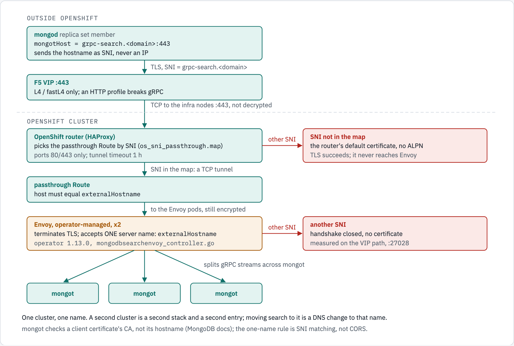
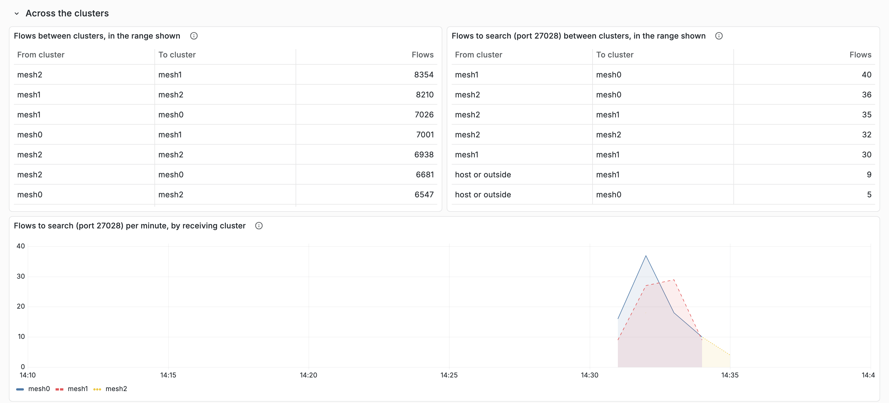
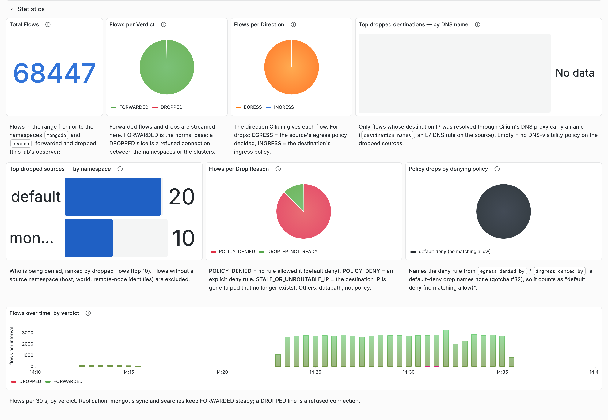
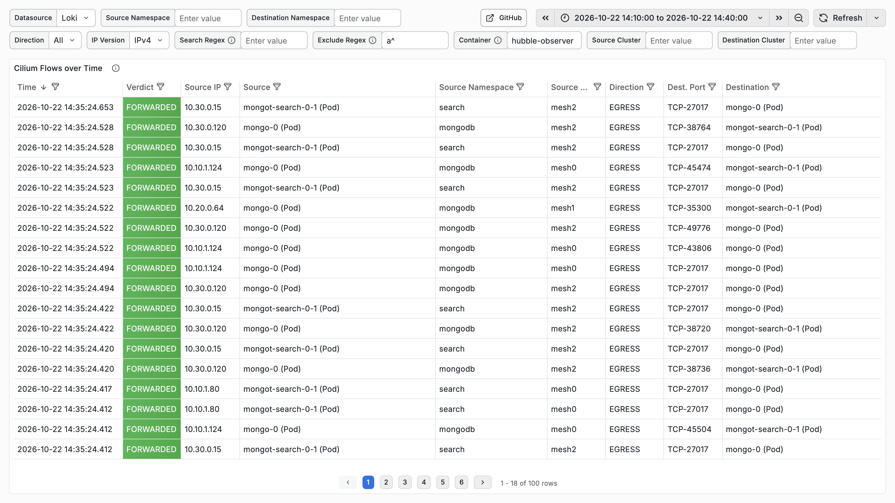

# Business case: MongoDB Search across clusters on Cilium Cluster Mesh

Why this lab runs MongoDB Search across three Kubernetes clusters on Cilium Cluster Mesh rather than in the
conventional shape, what that solved, and what it costs. Every lab number is a measurement on the kind mesh lab, with
its record; the conventional entry's behaviour is from the OpenShift lab in the [README](../README.md), and the design
itself is in [the reference architecture](reference-architecture-search-on-cluster-mesh.md).

## The problem

A self-managed MongoDB Search deployment has two hops: each mongod sends its searches to mongot (`mongotHost`), and
each mongot reads the replica set it indexes. To survive the loss of a cluster, both hops must work across clusters,
and a mongod whose own mongot is gone must find another without a person changing anything.

The conventional shape does not give that:

- **One cluster, one name, one stack.** The search entry is a chain of hops: an F5 VIP that the name resolves to, which
  forwards the TLS untouched (L4), the OpenShift router choosing a passthrough Route by SNI, the Route whose host must
  equal the search's `externalHostname`, then the operator's Envoy, which terminates TLS. mongod must send that name as
  SNI, so `mongotHost` cannot be an IP ([README](../README.md#architecture-openshift-route-behind-an-f5)).
- **Envoy accepts exactly one name.** With TLS on, as the Route path requires, operator 1.13.0 gives a replica set one
  route, so Envoy's listener has one filter chain whose server names are a one-element list: the `externalHostname`,
  which *replaces* the in-cluster Service name rather than adding to it (at tag 1.13.0,
  `controllers/operator/mongodbsearchenvoy_controller.go` sets the name in `buildReplicaSetRouteForCluster` and
  `envoy_config_builder.go` the one-element `ServerNames` in `buildFilterChain`; the controller's lines are quoted in
  the [README](../README.md#one-hostname-two-entry-paths)). Another SNI on port 27028, the MetalLB VIP path: Envoy
  closes the handshake and serves no certificate; on port 443, the router serves its default certificate and the
  connection never reaches Envoy (measured with openssl s_client,
  [README](../README.md#what-a-wrong-sni-does-by-path)). This is server-name (SNI) matching during the TLS handshake,
  before any HTTP request: Envoy's filter chain on 27028, the router's passthrough map on 443. It is not CORS, an
  HTTP-header mechanism that browsers enforce ([MDN](https://developer.mozilla.org/en-US/docs/Web/HTTP/Guides/CORS));
  the operator's Envoy has no CORS filter, only its router (`buildFilterChain`). Nor is it mongot's: of the client
  certificates it is shown, mongot checks the CA (and the subject DN, when X.509 authorization is configured) but "does
  not validate the subject hostname or SAN entries"
  ([Secure the connection from MongoDB to Search, *Known Limitations*](https://www.mongodb.com/docs/kubernetes/current/fts-vs/configuration/secure-connection-mongodb-to-search/)).
  The name is "one string in four places": mongod's `mongotHost`, the Route's host, `externalHostname` and a SAN on
  Envoy's certificate, and "any mismatch drops the connection"
  ([README](../README.md#architecture-openshift-route-behind-an-f5)).
- **So a second cluster is a second stack under a second entry.** Moving search to it is a change to the DNS record of
  the one name in every mongod's `mongotHost` ("moving traffic to a different VIP is a DNS change, not a new name",
  [README](../README.md#one-hostname-two-entry-paths)); the README's shape has nothing that makes that change by itself,
  and this lab did not test anything that would.
- **The operator's own multi-cluster options do not fit a Community deployment.** Multi-cluster `MongoDB` needs Ops
  Manager or Cloud Manager; multi-cluster search (`spec.clusters` with several entries) is documented for Enterprise;
  `MongoDBCommunity` cannot place a member in another cluster; mongosync is not tested or supported with Community
  ([reference architecture, *Why this shape*](reference-architecture-search-on-cluster-mesh.md#why-this-shape)).
- **With the operator's Envoy, a cluster whose mongot are all lost keeps receiving its searches.** Envoy stays ready:
  its readiness probe is its admin `/ready` (operator 1.13.0, `mongodbsearchenvoy_controller.go`), which reports Envoy,
  not its mongot. Measured on this mesh in its first design, with the operator's Envoy behind `mongot-global`: nothing
  moved mesh2's searches when it lost both its mongot, and 160 of 234 failed for 82 s
  (`kind-mesh/output/drill-mongot-mesh2-both.txt`,
  [reference architecture](reference-architecture-search-on-cluster-mesh.md#behaviour-under-failure-measured)). The
  conventional shape itself was not drilled.

*The conventional entry, one cluster: the router, the Route and Envoy each match one name.*

## What Cilium Cluster Mesh gives instead

Cluster Mesh joins the clusters' networks, and a Cilium global Service has one name in every cluster, with the backends
of every cluster behind it. Every replica set member, and the search endpoint `mongot-global`, is such a Service: a
member's Service selects only its own pod, so its one backend is reachable by that name from all three clusters, and
`mongot-global` has every cluster's mongot behind it. Each mongod's `mongotHost` is
`mongot-global.search.svc.cluster.local:27028` in all three clusters; with `affinity: local` it goes to its own
cluster's mongot while one is ready, and to another cluster's when none is
([reference architecture, *Names*](reference-architecture-search-on-cluster-mesh.md#names-the-one-idea-that-makes-it-work)
and [*Without the operator's Envoy*](reference-architecture-search-on-cluster-mesh.md#without-the-operators-envoy-story-132)).

The Conventional column is the README's OpenShift entry, or, where a cell says so, this mesh with the operator's Envoy;
the Record column holds the records of the mesh column.

| What is needed | Conventional | On Cilium Cluster Mesh, measured | Record |
| --- | --- | --- | --- |
| One replica set across three clusters | The operator's multi-cluster `MongoDB`, with Ops Manager or Cloud Manager; `MongoDBCommunity` cannot ([*Why this shape*](reference-architecture-search-on-cluster-mesh.md#why-this-shape)) | Ordinary StatefulSets, one member per cluster; each member sees all three by their global Service names, healthy; no DNS rewrite | `kind-mesh/output/phase1-mongo.log` |
| Search in every cluster from the same data | A `MongoDBSearch` and an entry (VIP, Route) per cluster; not built here | Two indexes created once, through mesh0's mongod, were STEADY on all six mongot of the three clusters | `kind-mesh/output/check-two-mongot.txt` |
| A cluster loses all its mongot | Not drilled. With the operator's Envoy on this mesh: 160 of 234 searches failed (Envoy stays ready) | 0 of 235, and 0 of 236, before the network policy: mesh0 and mesh1 took mesh2's searches. With the policy, 1 to 3 failed at the deletion in each of 6 runs | `docs/testing-kind-mesh-cilium.md` (C4, C8); `kind-mesh-cilium/output/drill-mongot-mesh2-both-screenshots.txt` |
| Its mongot come back | Not drilled. With the operator's Envoy on this mesh, the searches never left mesh2; after a lost Envoy, they stayed remote until mongod restarted | Back to mesh2 by themselves | `docs/testing-kind-mesh-cilium.md` (C4); `docs/testing-kind-mesh.md` (T3, T4, T6) |
| Searches spread over a cluster's mongot | Envoy's round robin | Cilium's L7 load balancer: 20 and 20 | `kind-mesh-cilium/output/drill-spread-mesh2.txt` |
| The primary's cluster freezes | Not compared: the README's replica set runs outside OpenShift | mesh1 elected about 11 s after the freeze; no acknowledged write lost | [reference architecture](reference-architecture-search-on-cluster-mesh.md#behaviour-under-failure-measured) |
| Encryption between clusters | Not compared (one cluster); on its path mongod's TLS is terminated once, at Envoy, which opens a second mutual-TLS leg to mongot | WireGuard between all nodes: 3,221 WireGuard packets in 15 s of searches, and no cleartext gRPC on the nodes' bridge | `kind-mesh-cilium/output/wire-check.txt` |
| Only mongod may reach mongot | Envoy requires a client certificate; mongot checks its CA, not its hostname | A CiliumNetworkPolicy: probe pods in `default` or without `app=mongo`, and a host outside the mesh, got no answer; a probe pod labelled `app=mongo` in `mongodb` did | `kind-mesh-cilium/output/mongot-reach-policy.txt` |
| Seeing traffic across clusters | Not compared (one cluster) | One Hubble relay sees all six nodes; a pod's flow carries its source and destination cluster (a host's or an outside address's has none) | `docs/testing-kind-mesh.md` (T10); screenshots below |
| Entry hops to run | F5 VIP, router, Route and the operator's Envoy, per cluster; the router, the Route and Envoy each match the name | No F5, Route or operator Envoy: mongod dials a Service name, and Cilium's Envoy on the client's node splits the searches | `kind-mesh-cilium/README.md`; testing record, C7 |

*The same search on Cluster Mesh: one name everywhere, and the network moves a cluster's searches when its mongot are
gone.*

## Disaster recovery: what comes with it, and what does not

**Comes with the design, measured:**

- **Losing one cluster's search.** Its mongod's searches move to the other clusters by themselves and come back by
  themselves (the table above). On 2026-10-22, with the network policy in place (the probe record of that session
  shows it in mesh0 and mesh1), mesh2 lost both its mongot again: 235 searches were answered and 1 failed
  (`HostUnreachable`, at the moment of the deletion; `kind-mesh-cilium/output/drill-mongot-mesh2-both-screenshots.txt`).
  That makes 6 of 6 runs with the policy in which 1 to 3 searches failed at the deletion; without it, 1 of 3 runs on
  the same day, and 1 of 5 counting the two runs of 2026-10-21. The capture found no policy drop, and the record
  leaves open whether the policy makes that moment more likely
  ([testing record, C8](testing-kind-mesh-cilium.md#c8-only-mongod-reaches-mongot-a-ciliumnetworkpolicy)).
- **Losing the primary's cluster.** MongoDB's own election, over the mesh: a new primary 9.9 to 10.8 s after a freeze
  or a kill and 15.9 to 16.3 s after a partition; writes accepted again 10.3 to 10.7 s after a freeze or a kill and
  23.2 s after a partition, at the defaults; no acknowledged write lost or duplicated in any run
  ([testing record, story #131](testing-kind-mesh-cilium.md#story-131-the-primarys-cluster-is-lost) and
  [election tuning](testing-kind-mesh-cilium.md#election-tuning-after-story-131)). That is the replica set's doing;
  Cluster Mesh supplies the names and the reachability it needs.

**Does not come with it:**

- **Losing two of the three clusters.** No majority: no primary, no writes. That is the replica set's rule, not
  drilled.
- **Copies of data.** A global Service load-balances each connection to one backend and copies nothing. The search
  indexes are copies only because each cluster's mongot reads the same replica set. The observability data (Loki,
  metrics) has a second copy only if its writers send to two places
  ([shared services](shared-services-on-cluster-mesh.md), story #159, proposed).
- **A client's pause.** How long a failover pauses an application depends on its driver's timeouts and on the new
  primary: with `heartbeatFrequencyMS=2000&connectTimeoutMS=5000` no write failed, and the longest wait was 11.5 s
  (freeze), 9.7 s (kill) and 22.8 s (partition), the partition's set by the new primary's catch-up
  ([client guidance](reference-architecture-search-on-cluster-mesh.md#client-guidance)).

## Seeing it: the Hubble flows in Grafana

The flows from or to the `mongodb` and `search` namespaces of all three clusters go from mesh0's Hubble relay through
hubble-observer and an OpenTelemetry collector to Loki, and Grafana draws them (`kind-mesh/scripts/observability-up.sh`,
`kind-mesh/observability/values-hubble-observer.yaml`). The pictures below are 19:10Z to 19:40Z on 2026-10-22 (shown in
the browser's time, UTC−5; their data ends at about 14:35), taken with
`~/.local/share/diagram-kit/.venv/bin/python kind-mesh/scripts/grafana-screenshots.py --from 2026-10-22T19:10:00Z --to 2026-10-22T19:40:00Z`.
The policy probes started at 19:30:35Z (`kind-mesh-cilium/output/mongot-reach-screenshots.txt`), and the drill above
followed them; its record counts from its own start, and its file was written from 19:31:35Z to 19:33:40Z.

*Across the clusters ([dark](screenshots/kind-mesh-grafana-across-clusters.dark.png)). While mesh2 had no mongot, its
searches were received by mesh0 and mesh1; its own line resumes at the end. mesh1's 40 flows to mesh0, and the 14:31
points, match the policy probes: their pods run in mesh1 and dial mesh0's two mongot, before the drill. Flows, not
requests: Cilium reports an open connection at most every 5 s (its default `--monitor-aggregation-interval`).*

*Statistics ([dark](screenshots/kind-mesh-grafana-statistics.dark.png)). Seven drops in eight are `POLICY_DENIED`, and
they match the probes of `mongot-reach.sh` that the policy refused: two pods in `default` and one in `mongodb` without
`app=mongo` (their record), as in the 20 and 10 drops by source namespace, with the DROPPED slivers at 14:31.
`DROP_EP_NOT_READY` is Cilium's drop when an endpoint's policy program is not available, as when its pod is
terminating (Cilium 1.20.2 `bpf/lib/local_delivery.h`); in this window the drill deleted mesh2's two mongot and the
probe script its four pods, and the picture does not show which. Before about 14:23 in the browser's time the record
is almost empty: no flows to 14:12, about 100 to 150 per 30 s to 14:16, none to 14:23. The VM was restarted for #182
from 14:10 to about 14:19 (its records, `kind-mesh/output/disk-grow-2026-10-22/`), and the collector was OOMKilled 141
times in 16 hours until #184 ([testing record](testing-kind-mesh.md#problems-found-while-building-and-the-fix)); the
records do not say which lost which minutes.*

*Each flow with its source cluster; the destination's namespace and cluster are further right in the same table
([dark](screenshots/kind-mesh-grafana-history.dark.png)); also
[unique flows](screenshots/kind-mesh-grafana-unique-flows.png), [raw flow lines](screenshots/kind-mesh-grafana-raw-flows.png)
and [flows to search per receiving cluster](screenshots/kind-mesh-grafana-search-per-cluster.png). The search GUI
showed a failover of the same kind on 2026-10-21, from the application's side
([testing record, C4](testing-kind-mesh-cilium.md#c4-a-cluster-loses-all-its-mongot-then-gets-them-back)).*

## What it costs

- **MongoDB's TLS on the search hop is replaced by WireGuard between nodes**, because Cilium's L7 load balancer reads
  cleartext gRPC. Inside a node, mongod and mongot speak cleartext; mongod's connections to the replica set keep TLS.
- **Cilium's L7 load balancing is beta in 1.20**, with outlier detection and no health checks (Cilium v1.20.2: the
  guide's title, "Proxy Load Balancing for Kubernetes Services (beta)"; `operator/pkg/ciliumenvoyconfig/envoy_config.go`
  ejects a backend after 2 local connection failures and sets no health check).
- **Rolling Cilium's agents disturbs search.** On 2026-10-22, replacing each cluster's agents with our build under
  load, searches timed out for about a minute per cluster (8 through mesh0, 9 through mesh2; writes 0 of 1,091
  failed), and one cluster's mongod kept a connection that bypassed the L7 load balancer until it reconnected (#187,
  open).
- **Every cluster of the mesh must run WireGuard.** While one did and two did not, the encrypting cluster's mongod was
  cut off.
- **The network policy's trust is a namespace and a label**: whoever can create a pod labelled `app=mongo` in
  `mongodb` reaches mongot. It also leaves 9946 open to every node of the mesh and every port to the local host
  ([reference architecture](reference-architecture-search-on-cluster-mesh.md#without-the-operators-envoy-story-132)).
- **The clusters need distinct pod and Service ranges and a unique `cluster.id`**, and one CA for the whole system.
- **Support.** MongoDB documents an external source for search, which each cluster's `MongoDBSearch` uses here, as
  Enterprise-only; the operator does not check it, and the lab runs Community. The replica set's StatefulSets are this
  repository's: initiation, users, TLS rotation and upgrades are ours to run
  ([reference architecture, *What is not proven*](reference-architecture-search-on-cluster-mesh.md#what-is-not-proven)).

## What is not proven

The lab is three kind clusters on one machine. Production scale, real network latency between sites, and the company's
clusters are not tested; the reference architecture lists the rest
([*What is not proven*](reference-architecture-search-on-cluster-mesh.md#what-is-not-proven)).

## Diagram sources

The two figures are `diagrams/business-case/source.html`, rendered with diagram-kit
(`~/.local/share/diagram-kit/.venv/bin/diagram-render docs/diagrams/business-case/source.html docs/diagrams/business-case conventional,mesh`).
The screenshots are made by `kind-mesh/scripts/grafana-screenshots.py`. Picture, caption and source change together.
