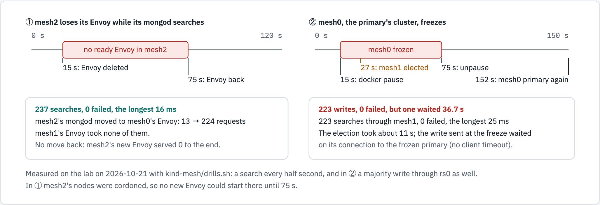

# Reference architecture: MongoDB Search across Kubernetes clusters on Cilium Cluster Mesh

One MongoDB replica set with a member in each of three Kubernetes clusters, and one mongot in each cluster. The
clusters are joined by Cilium Cluster Mesh, which does the multi-cluster part: every replica set member and the search
endpoint are Cilium global Services, with one name in every cluster. Each cluster's mongod searches through its own
mongot, and through another cluster's when its own is unreachable.

Built and measured on three kind clusters on 2026-10-21 (`kind-mesh/`: the scripts, the proofs and the drills). Every
number below comes from that lab. What it has not shown is said in [What is not proven](#what-is-not-proven).

## In short

- **The network carries the topology, not MongoDB's tooling.** The replica set's members are ordinary StatefulSets,
  one per cluster, reached by global Service names. No Ops Manager, no operator multi-cluster topology, no
  cluster-to-cluster sync tool.
- **Writes and replication: MongoDB's own.** One primary, two secondaries, majority writes. Losing the primary's
  cluster elected another primary about 11 s after the freeze: the 10 s election timeout, then 0.25 s.
- **Search: mongot in each cluster (one, then two), all syncing from the same replica set.** An index created once was STEADY on all
  three mongot. Each cluster's mongod reaches its own mongot through one global name, `mongot-global`, with local
  affinity.
- **Failover of search is per connection.** A cluster that lost its Envoy moved its searches to another cluster with
  no failed search, and stayed there after its own Envoy returned.
- **The client's timeouts decide how long a failover pauses it.** With mongosh's defaults, a write sent at the moment
  the primary's cluster froze waited 36.7 s and then succeeded; with 5 s connect and socket timeouts the longest wait
  was 10.0 s, but two writes failed and needed the application's retry. Both times mongod's log showed the election
  start at the 10 s election timeout and end 0.25 s later (that log is not in `kind-mesh/output/`).
- **No acknowledged write was lost or duplicated.** The old primary rolled back exactly one write per freeze: with the
  default client its retry was already on the new primary; with 5 s timeouts it was one the client was told had failed.

Then without the operator's Envoy (story #132), a search every half second through mesh2's own member:

| mesh2 loses… | Operator's Envoy | Step 1: no Envoy | Step 2: Cilium balances each search |
| --- | --- | --- | --- |
| all its mongot | 160 of 234 failed | 0 of 237 | 0 of 235, then 0 of 236 |
| one mongot | 0 of 237 | 0 of 237 | 0 of 237 |
| when they come back | stays remote until mongod restarts | stays remote until mongod restarts | returns to mesh2 by itself |
| spread over a cluster's two mongot | Envoy's round robin | no | yes, 20 and 20 |

## Why this shape

| Option | What it needs | Why not here |
| --- | --- | --- |
| The operator's `MongoDBCommunity` CRD | One cluster | It cannot place members in another cluster: no field for them, and seed hosts come only from its local StatefulSet (MCK 1.13.0, `community_search_source.go:32-36`). Its automation agent would undo a member added by hand |
| The operator's multi-cluster `MongoDB` / `MongoDBMultiCluster` | Ops Manager or Cloud Manager credentials (CRD fields `credentials`, `opsManager`, `cloudManager`) | Vendor tooling for HA and DR, which this design avoids |
| The operator's multi-cluster search (`spec.clusters` with several entries) | An external source, the managed load balancer, one operator with access to every cluster (`mongodbsearch_validation.go:102-110`, `:729-739`); MongoDB documents it for Enterprise only | Same: vendor topology. One `MongoDBSearch` per cluster, each with an external source, does the same job with no cross-cluster operator |
| Separate replica sets synced by mongosync | mongosync | MongoDB does not test or support mongosync with Community builds |
| **One replica set over the mesh, one `MongoDBSearch` per cluster** | Pod-to-pod reachability and shared names across clusters: Cilium Cluster Mesh and global Services | Chosen |

## The architecture


*The design as built. The member Services and `mongot-global` are global Services: one name in every cluster.*

```text
            cluster A                      cluster B                      cluster C
ns mongodb  mongod (PRIMARY, priority 2)   mongod (SECONDARY, priority 1) mongod (SECONDARY, priority 1)
            Service mongo-A ◀──── global, one backend each, resolvable in every cluster ────▶ mongo-C
ns search   operator · Envoy · mongot      operator · Envoy · mongot      operator · Envoy · mongot
            Service mongot-global (global, affinity local) over the Envoy pods, in every cluster
mongod --mongotHost=mongot-global...:27028 → its own cluster's Envoy → its own mongot
each mongot syncs from rs0 by the three member names
```

### Building blocks

| Layer | What | In the lab |
| --- | --- | --- |
| Clusters | Three clusters, each with its own pod and Service ranges (Cluster Mesh needs them distinct) | kind v0.33.0, Kubernetes v1.36.4; pods 10.10/10.20/10.30.0.0/16, Services 10.11/10.21/10.31.0.0/16; one control plane and one worker each |
| Network | Cilium as CNI with kube-proxy replacement; Cluster Mesh; each cluster a unique `cluster.id` | Cilium 1.20.2, mesh apiserver on a NodePort, KVStoreMesh; LoadBalancer addresses from Cilium LB IPAM and L2 announcements |
| Trust | One root CA for the whole system, the same in every cluster | cert-manager v1.21.1; the root made once and copied as a Secret; a `ClusterIssuer` in each cluster |
| Database | One replica set, one member per cluster, a StatefulSet each | MongoDB Community 8.3.4, `rs0`, keyfile authentication, TLS required |
| Search | One `MongoDBSearch` per cluster with an external source; the operator's managed Envoy in front of mongot | MongoDB Controllers for Kubernetes 1.13.0 through OLM v0.46.0; mongot 1.70.1; this repository's chart (`chart/mongodb-search-helm`) with `kind-mesh/values/search.yaml` |

### Names: the one idea that makes it work

A replica set's members find each other, and drivers find them, by the host names in the replica set configuration.
Those names must resolve, and reach the same member, from every cluster.

- **One Service per member, `mongo-<cluster>`, declared in every cluster** with `service.cilium.io/global: "true"`.
  It selects its member by a label only that cluster's pod carries, so its single backend is in its own cluster and
  Cilium merges it into every cluster's view (`kind-mesh/manifests/11-member-services.yaml`).
- **The replica set is initiated with those names** (`mongo-mesh0.mongodb.svc.cluster.local:27017`, …). Nothing else
  is needed: no DNS rewrite, no split horizon. Measured: every member sees the other two healthy
  (`kind-mesh/output/phase1-mongo.log`).
- **Each member's certificate names its own Service**, so TLS verification holds from any cluster.
- **The search endpoint is one more global name, `mongot-global`**, over every cluster's Envoy, with
  `service.cilium.io/affinity: local` (`kind-mesh/manifests/22-mongot-global.yaml`). It is our own Service, not an
  annotation on the operator's, which the operator owns.

### The three paths

| Path | From → to | How |
| --- | --- | --- |
| Writes and replication | Client → primary; primary → secondaries | Ordinary replica set traffic, member to member through the member Services, over the mesh. Majority writes need two of three clusters |
| Search | mongod → mongot | Each mongod's `mongotHost` and `searchIndexManagementHostAndPort` are `mongot-global.search.svc.cluster.local:27028`, set from its first start (`kind-mesh/manifests/13-mongod.yaml`). Cilium sends it to its own cluster's Envoy; Envoy terminates TLS for that name and forwards to its own mongot |
| Sync | mongot → replica set | Each mongot's external source lists the three member names. Measured: two indexes created once, through mesh0's mongod, were STEADY on every mongot of the three clusters, by each mongot's own `indexStatusCode` (`kind-mesh/output/check-two-mongot.txt`); Hubble's flow table shows mongot pods reading from the members of other clusters |

### Security

- **One CA.** It signs every certificate: each mongod (server and client usage), each mongot, each Envoy (the name
  `mongot-global`), Cilium's mesh apiserver and Hubble. A mongod in one cluster therefore trusts the Envoy of any
  other with one CA file.
- **Replica set**: keyfile authentication between members; `--tlsMode=requireTLS`; clients without a certificate may
  connect and authenticate by password.
- **Users**: an administrator, and the sync user mongot logs in with, role `searchCoordinator`. The keyfile and both
  passwords are made once with `openssl`, kept only as Secrets in the clusters, and copied between clusters as data,
  never written to a file or an argument (`kind-mesh/scripts/mongo-up.sh`).
- **mongod → Envoy is mutual TLS**: mongod presents its own certificate as the client certificate.

## Behaviour under failure, measured



*The two drills, measured on the lab on 2026-10-21 (`kind-mesh/drills.sh`, outputs in `kind-mesh/output/`).*

| Event | What happened | Measured |
| --- | --- | --- |
| A cluster loses its Envoy (mesh2: nodes cordoned, Envoy pod deleted, 60 s) | Cilium sent mesh2's mongod to another cluster's Envoy | Three runs, each 237 searches, 0 failed, the longest 15 to 36 ms; taken over by mesh0's Envoy (run 1) or mesh1's (runs 2, 3) |
| Its Envoy returns | mesh2's mongod stayed on the other cluster's Envoy | mesh2's new Envoy served 0 requests to the end of the drill |
| One of a cluster's two mongot is lost | Envoy retried on the other | 0 of 237 searches failed; 8 retries (`drill-mongot-mesh2-one.txt`) |
| **All of a cluster's mongot are lost** | **Not failed over.** The operator's Envoy is ready by its admin `/ready` (port 9901), which reports Envoy's own state, not its mongot's; and Cilium moves a connection only when a cluster has no ready Envoy | One mongot per cluster: 167 of 235 searches failed for 85 s. Two per cluster, both lost: 160 of 234 failed for 82 s; Envoy retried 32 times on nothing (`drill-mongot-mesh2-only.txt`, `-both.txt`) |
| The primary's cluster freezes (mesh0: both nodes paused, 60 s) | mesh1 was elected primary; writes and searches went on | mesh1's election started at the 10 s election timeout and completed 0.25 s later. Default client: 223 writes and 223 searches, 0 failed, one write waited 36.7 s. Client with `connectTimeoutMS=5000&socketTimeoutMS=5000`: longest write 10.0 s, 2 of 266 writes failed (connect timeout), 0 searches failed |
| It returns | mesh0 rolled back its unreplicated writes, caught up and took the primary back (priority 2). Rolled back: exactly 1 document of `lab.drill` per freeze. Default client: its retry was on the new primary, once. 5 s timeouts: not on the primary, a write the client was told had failed. `lab.drill` holds exactly the 710 acknowledged writes of the three runs (`kind-mesh/output/evidence-2026-10-21.txt`) | PRIMARY at the first check, 77 s after the unpause (the drill checked only after its load ended, so this is an upper bound) |
| Two clusters lost | No majority: no primary, no writes. Searches on the remaining member are answered from its mongot's last state | Follows from the replica set's rules; not drilled |

What this means for operating it:

- **Search failover is per connection, not per search.** mongod keeps its gRPC connections to mongot open, so a
  failover moves them once and nothing moves them back until mongod reconnects. After a cluster's Envoy returns, its
  mongod's searches still cross the mesh. Measured: after mesh2's Envoy returned, a search through mesh2's member
  added nothing to mesh2's Envoy; after mesh2's mongod was restarted, it did (`kind-mesh/drills.sh failback`,
  `kind-mesh/output/drill-failback-mesh2.txt`).
- **A cluster with a broken mongot keeps sending its searches to it.** Failover covers a lost Envoy, not a lost
  mongot behind a ready Envoy. To cover both, Envoy's readiness would have to follow its mongot's, which the
  operator's Envoy does not do today.

## The application

The repository's search GUI (`app/gui/server.py`) runs in mesh0 (`kind-mesh/scripts/gui-up.sh`). It runs `$search`
and `$vectorSearch` through MongoDB only, through the replica set or through a chosen cluster's member, and names the
cluster whose mongot answered by reading each cluster's mongot counter before and after the query: every cluster's
metrics endpoint, one per mongot pod, is a global Service of its own (`kind-mesh/manifests/30-mongot-metrics.yaml`). It logs in as
`search-gui`, which may read `sample_mflix` and nothing else. The vectors are the sample data's 5-dimension
`plot_embedding` values and a fixed vector per theme word: the mechanics of vector search, not semantic search.

## Without the operator's Envoy (story #132)

Cilium is already the service mesh, so Step 1 removed the operator's Envoy: each MongoDBSearch uses
`loadBalancer.unmanaged`, and `mongot-global` points straight at the mongot pods (`kind-mesh-cilium/`). An unready
mongot then loses its endpoint, and a cluster with no ready mongot sends its mongod's new connection to another
cluster. mongod and mongot keep mutual TLS.

Step 2 then made Cilium balance each search request: WireGuard on all three clusters, Cilium's L7 load balancer
(`service.cilium.io/lb-l7`) on `mongot-global`, and cleartext gRPC on the search hop, because that balancer reads
cleartext only. Between nodes and clusters it travels inside WireGuard.

The search side is installed by the lab's own chart, `kind-mesh-cilium/chart/mongodb-search-cilium` (not released;
`kind-mesh-cilium/README.md`): the operator through OLM, the MongoDBSearch with `loadBalancer.unmanaged`, and
`mongot-global`. `searchTLS.enabled` and `globalService.lbL7.enabled` choose Step 1's or Step 2's form. Cilium's
settings and each mongod's `searchTLSMode` are set outside it. Steps 1 and 2 were first applied by hand; the chart then
took over the same objects without rolling a mongot. The repository's main chart is unchanged: it always renders the
operator's Envoy.

| mesh2 loses… | With the operator's Envoy | Step 1: per connection | Step 2: per request |
| --- | --- | --- | --- |
| all its mongot | 160 of 234 searches failed | 0 of 237 | 0 of 235, and 0 of 236; mesh0 and mesh1 shared them evenly |
| one mongot | 0 of 237 | 0 of 237 | 0 of 237 |
| — and when they come back | remote until mongod restarts | remote until mongod restarts | **back to mesh2 by itself** |
| searches spread over a cluster's mongot | Envoy's round robin | no | yes, 20 and 20 |

Measured on 2026-10-21 (`docs/testing-kind-mesh-cilium.md`). On the wire, during searches: 3,221 WireGuard packets
between nodes, and none of cleartext gRPC, mongod, VXLAN or the search text (`kind-mesh-cilium/output/wire-check.txt`).

What this trades:
- **MongoDB's own TLS on the search hop is replaced by WireGuard between nodes.** Inside a node, mongod and mongot speak
  cleartext gRPC. mongod's connections to the replica set keep TLS.
- **Cilium's L7 load balancing is beta in 1.20.** Its generated configuration drops a backend after 2 connection failures
  (outlier detection) and runs no health checks (Cilium v1.20.2 `operator/pkg/ciliumenvoyconfig/envoy_config.go`).
- **Every cluster of the mesh must run WireGuard.** While one did and two did not, the encrypting cluster's mongod was
  cut off (the replica set elected another primary on its own).
- **WireGuard encrypts; it does not decide who connects.** A pod in mesh1's `default` namespace, and a host outside
  WireGuard given a route, both reached mongot's cleartext port (`kind-mesh-cilium/output/wireguard-reach.txt`). A
  CiliumNetworkPolicy in every cluster (`kind-mesh-cilium/manifests/60-mongot-ingress.yaml`) limits 27028 to the mongod
  pods of the three clusters, naming the cluster label in its selector; tested: other pods and the host get no answer,
  mongod does, and the check passes. When a cluster loses all its mongot, 1 to 3 searches failed at the deletion in each
  of 5 runs with the policy and in 1 of 3 without; whether the policy adds to that is not settled (testing record, C8).
  Its trust is a namespace and a label, and it leaves 9946 open to every node of the mesh and every port to the local
  host. Cilium's ingress encryption strict mode is not tested. Cilium's mTLS options do not apply here: ztunnel (beta)
  is "currently not compatible with Cluster Mesh", and the SPIRE-based mutual authentication is deprecated in 1.20 and
  has no trust domain across clusters (Cilium 1.20 docs).

## Watching it

- **Hubble**: one relay sees the whole mesh (mesh0's reaches all six nodes; one CA). The UI runs in mesh0. The CLI
  needs a client certificate from the same CA, since the relay requires mutual TLS. The commands are in
  `docs/testing-kind-mesh.md`.
- **Grafana flows dashboard** (`kind-mesh/scripts/observability-up.sh`): the relay → hubble-observer → an
  OpenTelemetry collector → Loki → Grafana, in mesh0.
  - It shows the flows from or to `mongodb` and `search`, forwarded and dropped, with their source and destination
    cluster (the dashboard from the operator's fork of hubble-observer).
  - A first row shows the mesh as a whole: flows by pair of clusters, and flows to search (port 27028) by the cluster
    that received them: flows, not requests (Cilium reports an open connection at most every 5 s).
  - Measured: all nine pairs of clusters carry flows. After the Envoy drill the dashboard showed mesh2's searches
    still received by mesh1.

## Client guidance

- **Set `heartbeatFrequencyMS=2000&connectTimeoutMS=5000` on the client** (story #131, `docs/testing-kind-mesh-cilium.md`).
  With the primary's cluster frozen, its mongod killed, or the cluster cut off, no write failed in any run, and the
  longest wait was 11.5 s, 9.7 s and 22.8 s. With the defaults no write failed either, but one waited 37.7 s (freeze)
  and 47.2 s (partition) on its connection to the lost primary. `timeoutMS=10000`, or 5 s connect and socket
  timeouts, cap the wait at 10.0 s, but up to 4 writes failed per run, so the application must retry them. One run per
  setting, mongosh 2.6.0; another driver should be measured the same way (`kind-mesh-cilium/drills.sh primary`).
- **Elected is not writable.** A new primary accepts writes only after its catch-up, which waits for a heartbeat
  result from every member; a member that does not answer gives one after `heartbeatTimeoutSecs` (10 s). After a
  partition at the defaults, the new primary was elected at 15.0 s and accepted writes at 23.2 s.
- **Election settings trade a shorter outage for needless elections**
  (`docs/testing-kind-mesh-cilium.md#election-tuning-after-story-131`, two rounds, one VM):

  | Replica set settings | Longest without an acknowledged write: freeze / kill / partition | Shortest link outage that caused an election (tried: 1.5, 3, 4.5, 6, 9 s) |
  | --- | --- | --- |
  | defaults (`electionTimeoutMillis` 10000) | 11.0 / 10.6 / 23.4 s | none up to 9 s |
  | `electionTimeoutMillis=5000` | 11.4 / 5.5 / 11.3 s | 4.5 s |
  | `electionTimeoutMillis=5000`, `catchUpTimeoutMillis=0` | 7.3 / 5.2 / 8.2 s | 4.5 s |
  | `electionTimeoutMillis=2000`, `catchUpTimeoutMillis=0` | 7.3 / 2.2 / 9.1 s | 1.5 s |

  `electionTimeoutMillis` alone helps only when the primary's connections close (a crash); a silent loss still waits
  for the catch-up. `catchUpTimeoutMillis=0` removes that wait; writes that reached another secondary but not the new
  primary are then rolled back, which can include `w: 1` writes reported as successful, never majority writes. Below 5000, the client's own detection (`connectTimeoutMS=5000`) is the longer
  wait. A needless election interrupts writes twice: once to the new primary, once back to the preferred one. Measure
  the real network's outages before shortening anything; the lab runs the defaults.
- **Connect with all three member names and `replicaSet=rs0`**, so the driver follows the primary across clusters.
- **Read from the local member by connecting to it** (`directConnection=true` with `readPreference=nearest`, as the GUI
  and the drills did) when reads may be stale and should stay in their cluster; searches run on secondaries too.
  Through the replica set, `nearest` may pick any member within 15 ms of the closest (`localThresholdMS`), not only
  the local one.
- **Use majority writes**: they are what survives the loss of one cluster.

## Sizing (the lab, sample data)

| Workload | Requested | Used, measured | Volume |
| --- | --- | --- | --- |
| mongod | 500m, 1Gi (limit 1 CPU, 2Gi) | 179 to 240 Mi | 10Gi |
| mongot | 500m, 1Gi (limit 2 CPUs, 2Gi; heap 512Mi) | 622 to 677 Mi | 10Gi |
| Envoy | the chart's default | 19 to 21 Mi | — |
| The whole lab: 3 clusters, 6 nodes, two mongot per cluster, Cilium, cert-manager, OLM, the GUI, the observability stack | | 13.1 of 16 GiB in the VM; 37 of 60 GB of disk (each node keeps its own copy of every image) | |

Read with `kubectl top` and `free -m` (`kind-mesh/scripts/evidence.sh`, `kind-mesh/output/evidence-2026-10-21.txt`). These fit 24 documents and two indexes. Production sizing follows the chart's own guidance
(`chart/mongodb-search-helm/production-settings.md`), per cluster.

## From the lab to production

| Lab | Production |
| --- | --- |
| kind clusters on one VM | Three clusters in separate failure domains, with the latency between them measured: a majority write waits for the second-closest member |
| Cilium Cluster Mesh | The same, or any multi-cluster network that gives pod-to-pod reachability and one Service name across clusters. On OpenShift, Cilium as the CNI is a cluster-install decision, not an add-on |
| One root CA from cert-manager | The company CA, as the chart already expects (`tls.certsSecretPrefix`, `tls.trustBundleConfigMap`) |
| OLM from OperatorHub's catalog; the Jobs' `oc` from a lab image | OpenShift's OLM and `certified-operators`; the chart's default `ose-cli` |
| One mongot per cluster | As many as each cluster's search load needs: `search.replicas` with the operator's Envoy spreading among them |
| The member StatefulSets from `kind-mesh/manifests/13-mongod.yaml` | The same shape, with the database team's settings: resources, storage class, backups, monitoring |

## What is not proven

- **All of a cluster's mongot lost behind a ready Envoy** is not failed over (measured above); without the operator's
  Envoy it is (Step 1 and Step 2 above).
- **Searches moving back** after a failover happen when mongod reconnects: a restart does it (measured); whether a
  connection is ever replaced by itself was not measured.
- **Client settings in other drivers**: story #131 measured mongosh 2.6.0 only, one run per setting.
- **Election settings on a real network**: the profiles ran twice and the outage test once, on one VM with links
  emulated by netem; a production network's outages, latency and load decide the right setting.
- **Latency between clusters**: all three clusters ran in one VM, so cross-cluster round trips were near zero.
- **Losing two clusters**, a partition that splits the other two clusters from each other, and a VM restart (node addresses may change, and
  the mesh is declared by address) were not run.
- **Support**: MongoDB documents an external source for search as Enterprise-only; the operator does not check it,
  and this lab runs Community. The replica set's StatefulSets are this repository's, not the operator's: initiation,
  users, TLS rotation and upgrades are ours to run.

## Diagram sources

The two figures are drawn in `docs/diagrams/kind-mesh/source.html` and rendered with diagram-kit
(`diagram-render docs/diagrams/kind-mesh/source.html docs/diagrams/kind-mesh design,drills`). The page, the PNGs and
this document change together.
