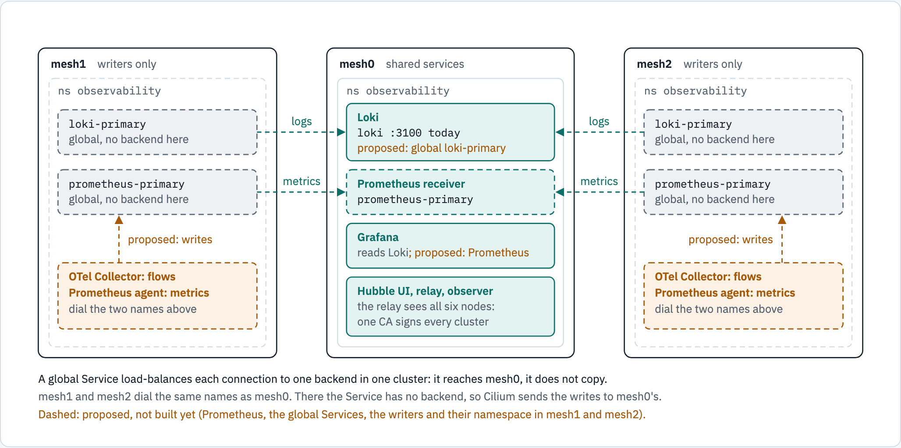
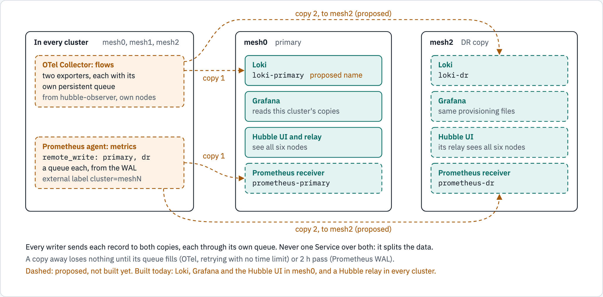

# Shared services on Cilium Cluster Mesh, and a copy for disaster recovery

The kind mesh lab runs its observability in one cluster: mesh0 has Loki, Grafana, the Hubble UI and the
hubble-observer. "Shared services" means every cluster uses them by name, through Cilium global Services, instead of
running its own. This note sets out that design, what a global Service does with the data written to it, and how a
second copy for disaster recovery (DR) gets its data. Researched on 2026-10-22; the work is story #159 (built on #146
and #147).

**Built today:** Loki, Grafana, the Hubble UI, one hubble-observer and its OpenTelemetry collector, all in mesh0 and
read there, and a Hubble relay in every cluster. **Proposed:** everything else in this note (the figures draw it
dashed).

## Shared services, reached through global Services

<!-- markdownlint-disable MD033 -->

<!-- markdownlint-enable MD033 -->

*mesh0 runs the shared services; the other clusters only write to them, by the same names. A global Service
load-balances each connection to one backend in one cluster: it reaches mesh0, it does not copy.*

```text
mesh1 (writers only)            mesh0 (shared services)                 mesh2 (writers only)
loki-primary        --logs-->   Loki             (loki :3100 today)   <--logs--     loki-primary
prometheus-primary  --metrics-> Prometheus receiver (proposed)        <--metrics--  prometheus-primary
  (global, no backend here)     Grafana: reads Loki and Prometheus here               (global, no backend here)
OTel Collector, Prometheus      Hubble UI, relay, observer: the relay sees            OTel Collector, Prometheus
  agent: dial the names above     all six nodes (one CA signs every cluster)            agent: dial the names above
```

- **Role-named, one backend cluster per name.** A Service such as `loki-primary` selects only mesh0's release; in the
  other clusters a Service of the same name has no endpoints, so their clients go to mesh0's backend. The lab already
  uses this for the GUI's metrics Services (`kind-mesh/manifests/30-mongot-metrics.yaml`), and
  cilium-implementation-poc for its hub (`prometheus-remote-write`, `tempo-central`, demo 22).
- **Release names must differ between clusters.** A release of the same name in another cluster is selected too and
  takes part of the writes (cilium-implementation-poc gotcha #69, measured as HTTP 404s from a receiver that was off).
- **Only the receivers are global.** A collector left global was load-balanced across clusters and stamped data with
  the wrong cluster (gotcha #70).

## Does a global Service copy the data? No

| What | Fact | Source |
| --- | --- | --- |
| A connection | Gets one backend, chosen at random among the Service's slots when it connects, and keeps it. With socket LB, on in the lab (cilium-dbg status, below the table: Socket LB Enabled, Coverage Full), the pod's socket is connected to the backend itself; on the per-packet path the choice is kept in conntrack and later packets follow it. A Loki push or a Prometheus remote_write on a kept-alive connection stays on one cluster | Cilium v1.20.2 `bpf/bpf_sock.c:123-127`, `:428`, `:460`; `bpf/lib/lb.h:2004-2015`, `:2321-2358`; `Documentation/network/clustermesh/global-services.rst:19-22` ("automatically perform load-balancing to pods in both clusters") |
| Mirroring | None in the L4 load balancer: a search of `pkg/clustermesh`, `pkg/loadbalancer` and `bpf/lib/lb.h` for mirror, fan-out and duplicate finds only EndpointSlice mirroring. The one request mirror is the Gateway API `RequestMirror` filter, for HTTP routes through Cilium's Envoy | git grep at v1.20.2; `operator/pkg/model/translation/envoy_virtual_host.go:436-457` |
| Two copies behind one name | Each would get part of the writes: affinity `none` pools both clusters' backends, `local` prefers the client's cluster | `pkg/clustermesh/selectbackends.go:60-91` |
| A name with no local backend | Its clients get the remote backends; the remote cluster must keep the Service `shared` (the default) | `pkg/clustermesh/testdata/clusterservice-without-local-eps.txtar`; `operator/watchers/service_sync.go:290-292` |
| Backends that go away | New connections go to the remaining ones. An existing connection to a deleted backend does not survive: with socket LB the socket stays connected to the gone pod (Cilium terminates such TCP sockets only with `lb-sock-terminate-all-protos`, off by default); on the per-packet path it is sent to another backend, which resets it. The writer reconnects. By default (`clustermesh.cacheTTL: 0s`) an unreachable cluster's backends are kept | `pkg/loadbalancer/reconciler/termination.go:212-219`; `bpf/lib/lb.h:2360-2391`; `global-services.rst:206-216` |

```bash
# A connection: socket LB in the lab
cilium-dbg status
```

So a second copy cannot come from a global Service. It comes from the writers, which send every record to both copies.

## A copy for disaster recovery: the writers send to both

<!-- markdownlint-disable MD033 -->

<!-- markdownlint-enable MD033 -->

*The DR copy holds everything because every writer sends to both, not because of the global Services, which only route
each write to the cluster that holds that name's backend.*

```text
In every cluster (mesh0, mesh1, mesh2)     mesh0: primary                mesh2: DR copy
OTel Collector, flows: two exporters  ---> Loki, loki-primary      ---> Loki, loki-dr
  (each its own persistent queue)          Grafana (this cluster's)      Grafana (same provisioning files)
Prometheus agent: remote_write             Hubble UI and relay           Hubble UI (its relay sees all six nodes)
  [primary, dr], a queue each from    ---> Prometheus receiver,    ---> Prometheus receiver, prometheus-dr
  the WAL; external label cluster            prometheus-primary
A copy away loses nothing until its queue fills (OTel, retrying with no time limit) or 2 h pass (Prometheus).
Never one Service over both.
```

| What | Fact | Source |
| --- | --- | --- |
| OpenTelemetry Collector, two exporters | "Each exporter gets a copy of each data element" (a fan-out). Each exporter has its own sending queue and retry, on by default, persistent with `storage`; a full queue drops new data unless `block_on_overflow` is set, which would stall the shared pipeline. Retry gives up on a batch after `max_elapsed_time`, 300 s by default; "If set to 0, the retries are never stopped" (the lab's collector sets 0: `kind-mesh/observability/20-otel-collector.yaml:39`) | https://opentelemetry.io/docs/collector/architecture/; https://github.com/open-telemetry/opentelemetry-collector/blob/main/exporter/exporterhelper/README.md |
| Loki | Replicates within one ring (`replication_factor`); "data replication across Loki clusters in different regions" is a stated non-goal | https://grafana.com/docs/loki/latest/get-started/components/; Loki operator, zone-aware replication proposal |
| Prometheus | `remote_write` takes a list; each destination has a queue that reads from the WAL, retried unless it stays down for more than 2 h. Agent mode keeps only that WAL | https://prometheus.io/docs/practices/remote_write/; https://prometheus.io/docs/prometheus/latest/prometheus_agent/ |
| Grafana | High availability needs a shared database; two independent instances can be provisioned from the same files | https://grafana.com/docs/grafana/latest/setup-grafana/set-up-for-high-availability/; https://grafana.com/docs/grafana/latest/administration/provisioning/ |
| Hubble | Each cluster's relay already sees all six nodes: one CA (`mesh-ca`) signs every cluster's Hubble certificates, and the relay checks each node's name, which includes its cluster | `kind-mesh/cilium/values-mesh.yaml:6-25`; `kind-mesh/scripts/up.sh:119-121`; Cilium v1.20.2 `pkg/hubble/peer/handler.go:165-179` |

The design:

- **Two names per service, one backend cluster each:** `loki-primary` and `prometheus-primary` in mesh0, `loki-dr` and
  `prometheus-dr` in mesh2.
- **The writers send to both.** Each cluster's collector has two exporters, each with its own persistent queue, no
  `block_on_overflow` and `retry_on_failure.max_elapsed_time: 0` (with the default 300 s, a copy away longer than
  5 minutes loses data while its queue still has room). Each cluster's Prometheus agent has two `remote_write` entries
  and the external label `cluster: meshN`.
- **The readers are local.** Each Grafana reads its own cluster's Loki and Prometheus, provisioned from the same files,
  so either survives the loss of the other cluster.
- **Storage.** What holds data needs a PVC; Grafana holds none.
  - Loki: a PVC today (`storage-loki-0`, 2Gi, 6 h retention, `kind-mesh/observability/values-loki.yaml`).
  - Each Prometheus receiver: a PVC for its database. Without a `storageSpec` the Prometheus Operator gives it an
    `emptyDir`, lost when the pod moves (cilium-implementation-poc's Prometheus values set none).
  - Each Prometheus agent: a PVC for its WAL, so its 2 h buffer survives a reschedule, when a receiver is likeliest away.
  - Grafana: an `emptyDir` is enough. Its data source is in the values and its dashboards come from ConfigMaps through
    the sidecar, so a restart loses only edits made in the UI, and the DR Grafana is the same files.
  - The lab's class, `standard`, is `rancher.io/local-path` with reclaim `Delete`: a deleted PVC deletes its data, and a
    volume pins its pod to one node. Sizes come from measured ingest; a reset script that lists the PVCs and deletes
    only when told to is part of #159.
- **The price:** a gap only when a copy is away longer than its queue lasts (the OTel queue's size, Prometheus's 2 h).

Decided on 2026-10-22: the existing clusters only (no fourth cluster, to save memory); the writers send to both;
Prometheus included.

## What is not proven

Nothing in this note past "built today" has run. Story #159 lists what is to be measured: memory before each step
(the VM had 1,240 MiB available on 2026-10-22, and Loki and Grafana alone have about 0.9 GiB of limits), the backend
cluster each name resolves to, the same counts in both copies, and two DR drills (the primary Loki and Prometheus
scaled to 0; mesh0 frozen).

## Diagram sources

The figures are drawn in `docs/diagrams/shared-services/source.html` and rendered with diagram-kit
(https://github.com/ephico2real2/diagram-kit), MPL-2.0. This document embeds the light pictures; the dark ones are
kept beside them. A figure, its text twin here and its page change together:

```bash
diagram-render docs/diagrams/shared-services/source.html docs/diagrams/shared-services shared,dr
```
