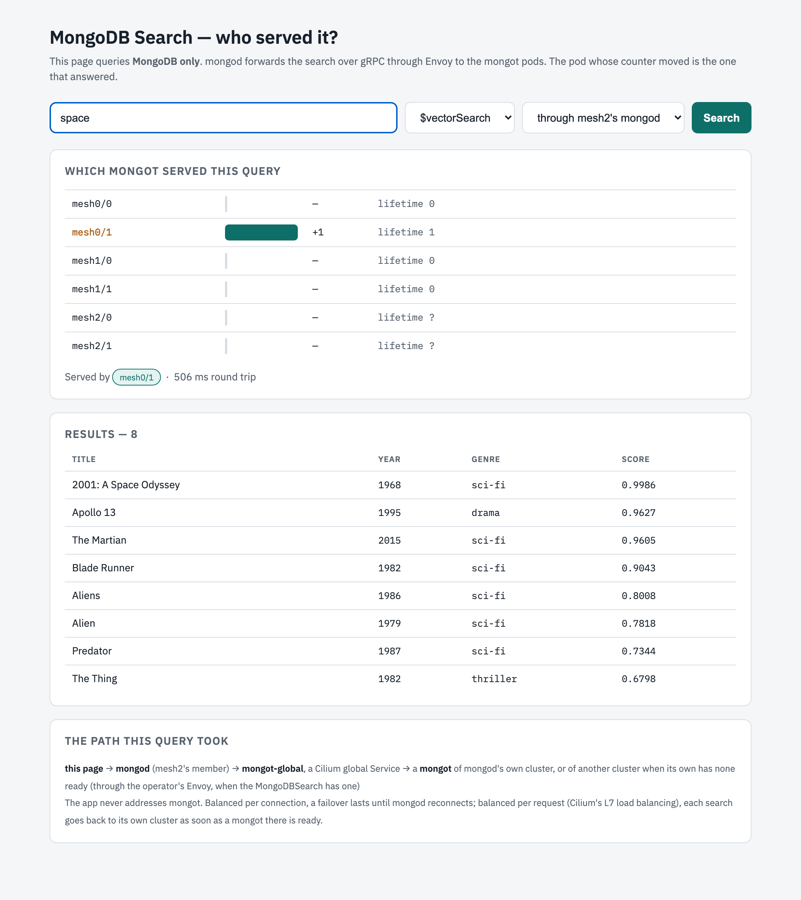
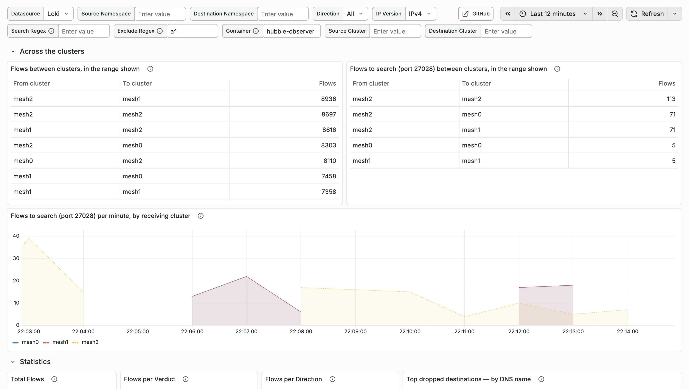

# Testing: MongoDB Search on Cilium alone, without the operator's Envoy (story #132)

What was tested on `kind-mesh-cilium/` on 2026-10-21, and how to repeat it. Every result below is in a file under
`kind-mesh-cilium/output/`. The lab it changes, and the baseline it is compared with, is in
[testing-kind-mesh.md](testing-kind-mesh.md).

The change: each cluster's MongoDBSearch keeps its two mongot but drops the operator's Envoy
(`loadBalancer.unmanaged`). `mongot-global`, the Cilium global Service every mongod dials, now points straight at the
mongot pods of the three clusters, and still prefers the local ones. mongod and mongot keep mutual TLS.

## Before you start

The Envoy lab built and passing (`kind-mesh/check.sh`). Then `export KUBECONFIG=~/.kube/mongodb-mesh.config`.

## Build

| # | What | Command | Passes when | Result |
| --- | --- | --- | --- | --- |
| S1 | Swap each cluster's search | `kind-mesh-cilium/scripts/swap-search.sh` | each MongoDBSearch Running with `loadBalancer.unmanaged`; no Envoy Deployment left | Passed, about 1 min a cluster; the operator rolled each cluster's mongot onto the new spec (`step1-swap.log`) |
| S2 | The lab is healthy | `kind-mesh/check.sh` | 0 failed | 0 failed: every mongot STEADY, a search through every member (`check-step1.txt`) |

## Step 1: no Envoy, balanced per connection

Each drill searches through mesh2's own member every half second for 120 s, and counts which cluster's mongot answered,
with mongot's own search counter. Step 1's records end in `.step1.txt`.

### C1. A cluster loses all its mongot

- **Run:** `kind-mesh-cilium/drills.sh mongot mesh2 both`. It removes both of mesh2's mongot from 15 s to 75 s.
- **Passes when:** no search fails.
- **Result: passed.** 0 of 237 failed. mesh0's mongot answered from then on (its count 1 → 212); the longest search
  took 244 ms (`drill-mongot-mesh2-both.step1.txt`).
- **Envoy lab, same drill:** 160 of 234 failed.

### C2. A cluster loses the mongot its mongod is connected to

- **Run:** `kind-mesh-cilium/drills.sh mongot mesh2 one`. It finds which of mesh2's mongot answers mesh2's searches
  and removes that one from 15 s to 75 s.
- **Passes when:** no search fails.
- **Result: passed.** 0 of 237 failed. mesh2's other mongot answered (mesh2's count 4 → 212, mesh0's unchanged)
  (`drill-mongot-mesh2-one.step1.txt`).

### C3. After a failover, do the searches come back?

- **Run:** after C1, `kind-mesh-cilium/drills.sh failback mesh2`.
- **Passes when (story #132's Step 2 target):** mesh2's searches return to mesh2's mongot without a restart.
- **Result: not yet.** Before the restart, mesh2's search was answered by another cluster. After a restart of
  mesh2's mongod, by mesh2's `mongot-search-0-1` (`drill-failback-mesh2.step1.txt`). This is the expected limit of a Service
  that balances connections: mongod keeps its connection. Step 2 (per-request balancing) is for it.

## Step 2: balanced per request, cleartext gRPC inside WireGuard

### Build

| # | What | Command | Passes when | Result |
| --- | --- | --- | --- | --- |
| S3 | WireGuard and Cilium's L7 load balancer in each cluster; the search hop to cleartext; `mongot-global` balanced per request | `kind-mesh-cilium/scripts/cleartext-l7.sh` | every Cilium agent reports `Encryption: Wireguard` before the search hop changes; each cluster gets a CiliumEnvoyConfig for `mongot-global` | Passed (`step2-apply.log`). During the Cilium upgrades, 819 searches through mesh2, 0 failed (`step2-load-cilium.txt`). The cleartext switch itself was not measured: the load ran in mesh2's mongod, which the switch restarts (`step2-load-cleartext.txt` ends at 29.4 s) |
| S4 | The lab is healthy | `kind-mesh/check.sh` | 0 failed | 0 failed (`check-step2.txt`) |

### C4. A cluster loses all its mongot, then gets them back

- **Run:** `kind-mesh-cilium/drills.sh mongot mesh2 both`
- **Passes when:** no search fails, and after mesh2's mongot return its searches go back to them with no restart.
- **Result: passed, twice.** 0 of 235 and 0 of 236 failed. During the outage mesh0 and mesh1 shared mesh2's searches
  evenly (30 and 30 at 45 s in the first run). After it, mesh2's mongot answered again (51 searches in each run), and
  the drill's last search was served by mesh2 (`drill-mongot-mesh2-both.step2.txt`, `drill-mongot-mesh2-both.txt`).

*During the outage, mesh2's search is served by `mesh0/1`. [Before](screenshots/kind-mesh-cilium-gui-before.png) and
[after](screenshots/kind-mesh-cilium-gui-after.png): `mesh2/0`, with no restart.*

*Grafana over both runs ([dark](screenshots/kind-mesh-cilium-grafana-failover.dark.png)): mesh2's searches went to mesh0
and mesh1 in equal numbers (71 and 71) during the outages, and to mesh2 the rest of the time.*

### C5. A cluster loses one of its mongot

- **Run:** `kind-mesh-cilium/drills.sh mongot mesh2 one`
- **Passes when:** no search fails.
- **Result: passed.** 0 of 237 failed; every search stayed in mesh2 (`drill-mongot-mesh2-one.step2.txt`). Searches
  are spread over the cluster's mongot: `kind-mesh-cilium/drills.sh spread mesh2` (`drill-spread-mesh2.txt`).

### C6. The search hop is encrypted between nodes

- **Run:** `kind-mesh-cilium/scripts/wire-check.sh` (needs `tcpdump` in the VM, as its header says).
- **Passes when:** no port 27028 or 27017 and no VXLAN cross the kind bridge in the clear, WireGuard does, and the search
  text is in no packet.
- **Result: passed.** 15 s of searches through the three members: 3,221 WireGuard packets; 0 on TCP 27028, 0 on TCP
  27017, 0 VXLAN; 0 packets containing "space" (`wire-check.txt`).

### What went wrong while applying step 2

| Run | What happened | Fix, now in `cleartext-l7.sh` |
| --- | --- | --- |
| 1 | After the Helm upgrade every agent still reported `Encryption: Disabled`: the agents read Cilium's configuration only when they start. The run was stopped before the search hop changed (its log was overwritten by run 2) | restart the agents after the upgrade; a gate that stops unless every agent reports WireGuard |
| 2 | mesh0's agents did not start: with the L7 backend on, they wait for CRDs the Cilium operator registers, and the operator had not been restarted (`step2-apply.run2-failed.log`) | restart the operator first and wait for its CRDs |
| 2 | While mesh0 encrypted and mesh1 and mesh2 did not, mesh0's mongod was cut off. The replica set elected mesh2 on its own, and mesh0 took the primary back once all three encrypted, with no action (`step2-mixed-mesh-evidence.txt`) | Cilium's docs say every cluster of a mesh must have WireGuard: the gate keeps the search hop unchanged until all do |

## Compared with the Envoy lab

| mesh2 loses… | With the operator's Envoy | Step 1: per connection | Step 2: per request |
| --- | --- | --- | --- |
| all its mongot | 160 of 234 searches failed | 0 of 237 | 0 of 235, and 0 of 236 |
| one mongot | 0 of 237 | 0 of 237 | 0 of 237 |
| — and when they come back | remote until mongod restarts | remote until mongod restarts | **back to mesh2 by itself** |
| searches spread over a cluster's mongot | Envoy's round robin | no: one connection, one mongot | yes: 20 and 20 |
