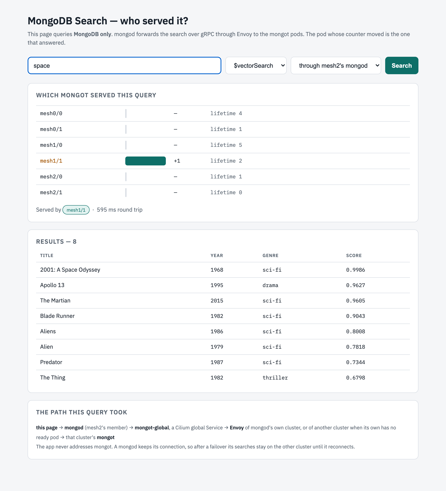
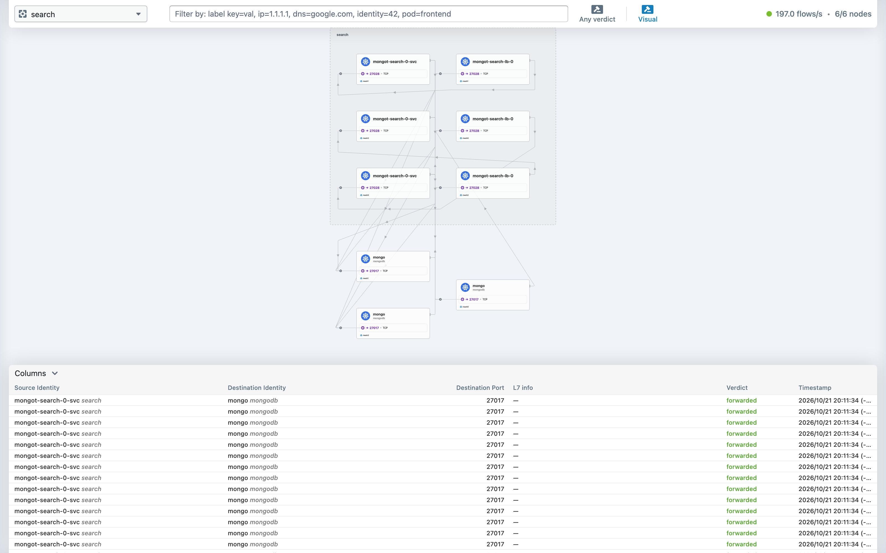
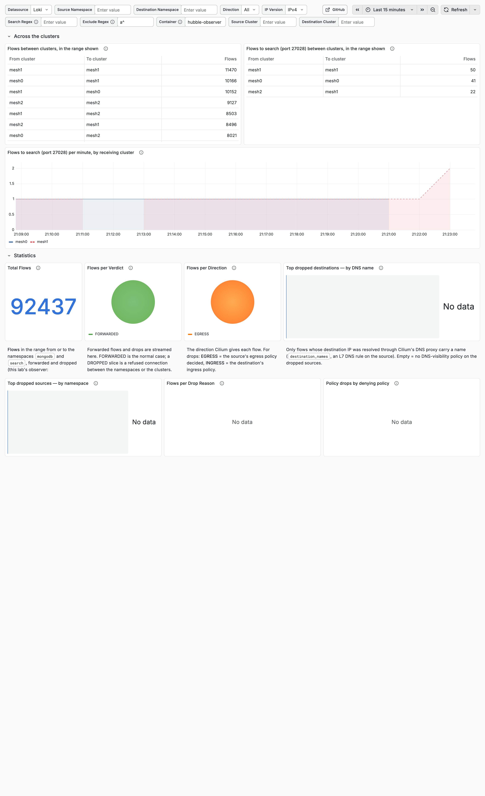
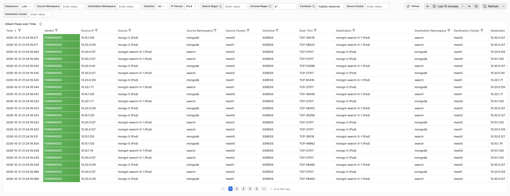

# Testing: MongoDB Search across three kind clusters (the Envoy lab)

What was tested on `kind-mesh/` on 2026-10-21, and how to repeat it. Every result below is in a file under
`kind-mesh/output/`. The design and the reasons for it are in
[the reference architecture](reference-architecture-search-on-cluster-mesh.md).

The lab: three kind clusters (`mesh0`, `mesh1`, `mesh2`) joined by Cilium Cluster Mesh, one MongoDB replica set with a
member in each, and in each cluster the chart's search: the operator, two mongot, and the operator's Envoy.

## Before you start

- macOS with Colima, kind 0.33.0, helm, kubectl, cilium-cli 0.20.0 (pins in `kind-mesh/versions.env`).
- Every command runs from the repository's root. For `kubectl`, first: `export KUBECONFIG=~/.kube/mongodb-mesh.config`.

## Build

| # | What | Command | Passes when | Result |
| --- | --- | --- | --- | --- |
| B1 | The VM and the platform | `kind-mesh/scripts/colima-up.sh && kind-mesh/scripts/up.sh` | each cluster is "2/2 connected" to the other two; one CA fingerprint in all three | Passed in 12 min 16 s from creating the VM (`phase0-up.log`) |
| B2 | The replica set | `kind-mesh/scripts/mongo-up.sh` | every member sees one PRIMARY and two SECONDARY; a second run also passes | Passed (`phase1-mongo.log`, rerun `phase1-mongo-rerun.log`) |
| B3 | Search in each cluster | `kind-mesh/scripts/search-up.sh` | the chart reports `deployed` in all three | Passed in 84, 75 and 75 s; then with `search.replicas: 2` (`phase2-search.log`, `phase2-search-two-mongot.log`) |
| B4 | Sample data and two indexes | `kind-mesh/scripts/data-load.sh` | both indexes queryable | Queryable after 18 s (`phase2-data.log`) |
| B5 | The search GUI | `kind-mesh/scripts/gui-up.sh` | it prints its address | `http://172.18.255.200/` (`gui-up.log`) |
| B6 | The flows dashboard | `kind-mesh/scripts/observability-up.sh` | five pods Running in `observability` | Passed (`observability-up.log`) |

## Test cases

### T1. The lab is healthy

- **Run:** `kind-mesh/check.sh`
- **Passes when:** every row is PASS. The rows check the mesh, the replica set, a write on every member, search in
  every cluster, every mongot holding both indexes, `$search` through every member, and volumes of 10Gi at most.
- **Result:** 0 failed, with one mongot per cluster (`check.txt`) and with two (`check-two-mongot.txt`).

### T2. Each cluster's searches are answered by its own mongot

- **Run:** `kubectl --context kind-mesh0 -n search port-forward svc/mongot-gui 8080:80`, then open
  `http://localhost:8080/?q=space&mode=vector&via=mesh1`. Repeat with `via=mesh0` and `via=mesh2`.
- **Passes when:** "Served by" names a pod of the same cluster.
- **Result:** mesh0 → `mesh0/1`, mesh1 → `mesh1/1`, mesh2 → `mesh2/0`.


### T3. A cluster that loses its Envoy keeps searching

- **Run:** `kind-mesh/drills.sh envoy mesh2`. It checks that mesh2's mongod uses mesh2's Envoy, then searches every
  half second for 120 s and removes mesh2's Envoy from 15 s to 75 s.
- **Passes when:** no search fails.
- **Result:** 0 of 237 failed, in each of three runs. The searches moved to mesh0's Envoy (run 1) or mesh1's
  (runs 2 and 3). After mesh2's Envoy came back, mesh2's new Envoy got 0 requests: **the searches did not move back**
  (`drill-envoy-mesh2.run1/2/3.txt`).



### T4. A restart of mongod brings its searches back

- **Run:** after T3, `kind-mesh/drills.sh failback mesh2`.
- **Passes when:** after the restart, a search through mesh2's member reaches mesh2's own Envoy.
- **Result:** before the restart, a search added 0 requests to mesh2's Envoy. After it, a search added 2
  (`drill-failback-mesh2.txt`).

### T5. A cluster that loses one of its two mongot keeps searching

- **Run:** `kind-mesh/drills.sh mongot mesh2 one`. It removes one mongot from 15 s to 75 s.
- **Passes when:** no search fails.
- **Result:** 0 of 237 failed. mesh2's Envoy retried 8 times, on the other mongot (`drill-mongot-mesh2-one.txt`).

### T6. A cluster that loses all its mongot

- **Run:** `kind-mesh/drills.sh mongot mesh2 both`. It removes both mongot from 15 s to 75 s.
- **Passes when:** no search fails, as the goal asks.
- **Result: fails.** 160 of 234 searches failed, from 14.7 s to 96.8 s, all `HostUnreachable`. mesh2's Envoy stayed
  ready and retried 32 times with no mongot behind it. The other clusters' Envoys got nothing: Cilium moves traffic
  only when a cluster has no ready Envoy. With one mongot per cluster: 167 of 235 failed
  (`drill-mongot-mesh2-both.txt`, `drill-mongot-mesh2-only.txt`). Story #132 is the fix to try.

### T7. The primary's cluster freezes

- **Run:** `kind-mesh/drills.sh cluster`. It writes (majority) and searches through mesh1 every half second, and
  freezes mesh0's two nodes (`docker pause`) from 15 s to 75 s.
- **Passes when:** another member becomes primary, and no write or search fails.
- **Result:** passed. mesh1 became primary 12 s after the freeze, by the drill's clock. 223 writes and 223 searches,
  0 failed. **One write waited 36.7 s**. mesh0 took the primary back after it returned (`drill-cluster.txt`).

### T8. The same freeze, with client timeouts

- **Run:** `CLIENT_OPTS="connectTimeoutMS=5000&socketTimeoutMS=5000" kind-mesh/drills.sh cluster`
- **Passes when:** the longest write is shorter than with the defaults.
- **Result:** the longest write took 10.0 s, but 2 of 266 writes failed on the connect timeout to the frozen member
  (`drill-cluster-connectTimeoutMS_5000-socketTimeoutMS_5000.txt`). Which settings to use is story #131.

### T9. No acknowledged write is lost or duplicated

- **Run:** `kind-mesh/scripts/evidence.sh`. It reads mesh0's `rollback/` files and looks up each rolled-back `_id` on
  the primary, in its own collection.
- **Passes when:** every acknowledged write is on the primary exactly once.
- **Result:** passed (`evidence-2026-10-21.txt`).
  - Each of the three freezes rolled back one document of `lab.drill`.
  - In the two default runs it was on the primary, once: the client's retry had written it.
  - In the run with timeouts it was not: it was one of the writes the client was told had failed.
  - `lab.drill` holds 710 documents, exactly the 223 + 223 + 264 acknowledged writes.
  - mongod's log shows each election start at the 10 s election timeout.
- The first freeze also rolled back 2 of mongot's heartbeat rows (`__mdb_internal_search.serverState`); both are on
  the primary now.

### T10. Hubble sees all three clusters

- **Run:** with a client certificate from the lab's CA, because the relay requires one:

  ```bash
  T=$(mktemp -d)
  for k in ca.crt tls.crt tls.key; do
    kubectl --context kind-mesh1 -n kube-system get secret hubble-relay-client-certs \
      -o jsonpath="{.data.${k//./\\.}}" | base64 -d > "$T/$k"
  done
  H=(--server localhost:4245 --tls --tls-ca-cert-files "$T/ca.crt" --tls-client-cert-file "$T/tls.crt" \
     --tls-client-key-file "$T/tls.key" --tls-server-name ui.hubble-relay.cilium.io)
  cilium hubble port-forward --context kind-mesh1 --port-forward 4245 &
  hubble list nodes "${H[@]}"
  hubble observe "${H[@]}" --to-namespace search --port 27028 --last 20
  rm -rf "$T"
  ```

- **Passes when:** `hubble list nodes` shows the six nodes of the three clusters as Connected.
- **Result:** passed: mesh0/…, mesh1/… and mesh2/… nodes, all Connected. Each agent handles 26 to 53 flows a second
  (`kind-mesh/scripts/evidence.sh`, `evidence-2026-10-21.txt`). The Hubble UI in mesh0 shows the same; it has no dark theme.



### T11. The flows dashboard names each flow's clusters

- **Run:** open Grafana (`kubectl --context kind-mesh0 -n observability port-forward svc/grafana 3000:80`, then
  `http://localhost:3000/d/hubble-observer-23862`; user `admin`, password in Secret `observability/grafana-admin`).
- **Passes when:** the flow table shows a Source Cluster and a Destination Cluster column, and "Flows between
  clusters" lists pairs of clusters.
- **Result:** passed. All nine pairs of clusters carry flows (`kind-mesh/scripts/evidence.sh`, `evidence-2026-10-21.txt`).





The dashboard comes from the operator's fork of hubble-observer, which added the cluster columns. This lab's
observer streams forwarded flows and drops between `mongodb` and `search`. The counts are Hubble flows, not search
requests: Cilium reports an open connection at most every 5 s.

## Resources

With two mongot per cluster, the GUI and the observability stack: 13.1 GiB of the VM's 16 GiB in use, 37 GB of its
60 GB disk. Per pod: mongod 179 to 240 Mi, mongot 622 to 677 Mi, Envoy 19 to 21 Mi (`kind-mesh/scripts/evidence.sh`,
`evidence-2026-10-21.txt`).

## Problems found while building, and the fix

| Problem | Fix |
| --- | --- |
| A new VM came back with the old clusters: `colima delete` keeps the docker disk | delete with `--data` |
| The chart's Jobs need `oc` for arm64 without a Red Hat login | the lab's own image, `kind-mesh/images/oc` (UBI plus Red Hat's `oc`, checked against its sha256) |
| The first user could not be created: the localhost exception allows only `createUser` | `mongo-up.sh` tries to log in first |
| A second run of `mongo-up.sh` failed: `rs.status()` needs a login once users exist | it checks `db.hello().setName` |
| The dashboard's cluster columns were missing | the dashboard from the fork, which added them |
| The dashboard could not show drops | the observer also streams `--type drop` |

## Open

- **#131**: which client settings bound the pause of a lost primary, without failing writes a retry would save.
- **#132**: search on Cilium alone, without the operator's Envoy. Target: T6 passes, and T3's searches move back
  without a restart.
