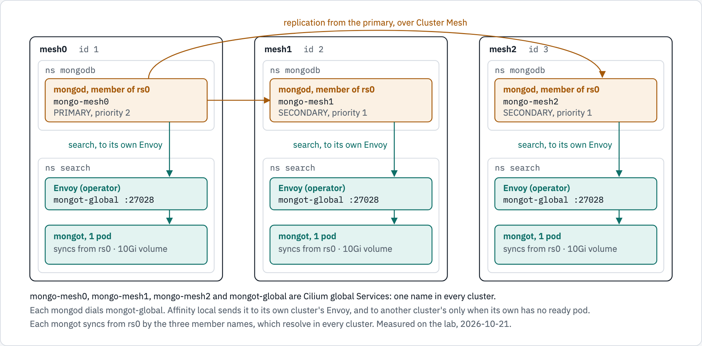

# kind mesh lab: MongoDB Search across three clusters

Three kind clusters joined by Cilium Cluster Mesh: one replica set with a member in each, and one mongot in each,
installed by this repository's chart. The design, why it is built this way and how it behaves under failure are in
[the reference architecture](../docs/reference-architecture-search-on-cluster-mesh.md). This page is how to run it.

## What runs where

Everything is in one Colima VM, `mongodb-mesh` (8 CPUs, 24 GiB, 100 GiB disk): the docker network `kind`, and in it six
node containers, one control plane and one worker for each of `mesh0`, `mesh1` and `mesh2`. The clusters' contexts
are in `~/.kube/mongodb-mesh.config`; the default docker context and `~/.kube/config` are not touched.

| In each cluster | |
| --- | --- |
| `kube-system` | Cilium 1.20.2 (the release chart; the agent is our build, `CILIUM_IMAGE` in `versions.env`, story #145; from #190 the mesh apiserver too, `CILIUM_CLUSTERMESH_IMAGE`) with its mesh apiserver, Hubble relay (and the Hubble UI in mesh0), metrics-server |
| `cert-manager` | cert-manager v1.21.1, the shared root CA, `ClusterIssuer mesh-ca` |
| `olm` | OLM v0.46.0 and OperatorHub's catalog |
| `mongodb` | One mongod, a member of `rs0`; the three member Services `mongo-mesh0`, `-mesh1`, `-mesh2` |
| `search` | The operator (1.13.0), two mongot (1.70.1), the operator's Envoy; `mongot-global`; the search GUI (mesh0) |
| `observability` (mesh0) | hubble-observer, an OpenTelemetry collector, Loki, Grafana: the flows dashboard |

## Run it

From the repository's root. Each script is idempotent and prints what it did; `output/` keeps the recorded runs.

| Step | Command | Time on the lab |
| --- | --- | --- |
| 1. The VM | `kind-mesh/scripts/colima-up.sh` | under a minute |
| 2. The platform: clusters, Cilium, cert-manager, the mesh, OLM | `kind-mesh/scripts/up.sh` | about 11 min 54 s (12 min 16 s with the VM) |
| 3. The replica set, its users and Secrets | `kind-mesh/scripts/mongo-up.sh` | about 1 min |
| 4. Search in every cluster: certificates, the chart, `mongot-global` | `kind-mesh/scripts/search-up.sh` | about 4 min: 84, 75 and 75 s a cluster |
| 5. Sample data and two search indexes | `kind-mesh/scripts/data-load.sh` | indexes queryable after 18 s |
| 6. The proofs | `kind-mesh/check.sh` | 19 PASS, 0 FAIL (`output/check.txt`) |
| 7. The drills | `kind-mesh/drills.sh envoy mesh2`, `mongot mesh2 one`, `mongot mesh2 both`, `cluster` | 2 to 2.5 min each |
| 8. The search GUI | `kind-mesh/scripts/gui-up.sh` | under a minute; at `http://172.18.255.200/` |
| 9. Hubble flows in Grafana | `kind-mesh/scripts/observability-up.sh` | about 2 min; at `http://172.18.255.201/d/hubble-observer-23862` (user admin, password in Secret `observability/grafana-admin`) |

To reach the clusters' LoadBalancer addresses from the Mac, `up.sh` prints the route to add, once per VM start (your
sudo; never run by the scripts).

**One command, from nothing to the lab as it is today:** `kind-mesh/scripts/rebuild.sh --yes` deletes the three
clusters (`down.sh`), then runs steps 2 to 5 and 8 to 9 above and `kind-mesh-cilium/`'s steps 1, 4, 6 and 9 (the swap,
step 2, the lab's chart, the network policy), then `check.sh`: each phase timed and logged under
`output/rebuild-<date>/`, stopping at the first failure. Without `--yes` it only prints what is lost (the replica
set's data and indexes, mongot's indexes, Loki's flows, Grafana's state, every password) and kept (the VM, the kind
network, the images in the VM's docker, the recorded runs). `--reclaim-docker` requires `--yes` and after the rebuild frees the VM docker's build cache
and unused images, never `localhost/kind-mesh/oc`, our Cilium images or kind's node image. What each step sets and
why: [docs/building-the-kind-mesh-lab.md](../docs/building-the-kind-mesh-lab.md).

**Which script owns which Cilium values.** `up.sh` installs each cluster's release from `cilium/values.yaml`,
`cilium/values-<cluster>.yaml` and, at the mesh step, `cilium/values-mesh.yaml`, with the images `versions.env` pins
(`lib.sh`, `cilium_image_args`). `kind-mesh-cilium/scripts/cleartext-l7.sh` adds `kind-mesh-cilium/cilium/values-step2.yaml`
(WireGuard, the L7 backend) on top, with `--reuse-values`; `kind-mesh-cilium/scripts/cilium-build.sh` changes the
images and nothing else (`--reset-then-reuse-values`). A re-run of `up.sh` on a lab after step 2 would render the
release without step 2's values, so it refuses before platform changes, naming #166: after step 2, the platform's scripts
are `colima-up.sh` and `rebuild.sh` only.

## The search GUI

The repository's GUI (`app/gui/server.py`), in mesh0, with two settings for the mesh: `MEMBERS`, so a search can go
through any cluster's member, and `MONGOT_TARGETS`, every mongot pod's metrics through a global Service each. Try
`space` or `detective` in `$vectorSearch` mode, through each member: the page names the cluster whose mongot answered.
Measured: through mesh0 and mesh1, their own; through mesh2, mesh0's for as long as mesh2's mongod kept the connection
it made during the Envoy drill, then mesh2's after that mongod was restarted.

## What check.sh proves

| Rows | Claim |
| --- | --- |
| 3 | Every cluster is connected to both others |
| 1 | `rs0` has one PRIMARY and two SECONDARY, all healthy |
| 3 | A write with `w: 3` is on every cluster's member |
| 3 | Every cluster's `MongoDBSearch` is Running and its mongot Ready |
| 3 | Every mongot holds both indexes, STEADY, by its own metrics |
| 3 | `$search` through every cluster's own member returns results |
| 3 | No volume is over 10Gi |

Each search's path was confirmed by the Envoys' counters: each cluster's search went through its own Envoy.

## The drills

| Drill | Result |
| --- | --- |
| `envoy mesh2`: mesh2 loses its Envoy for 60 s | 237 searches, 0 failed, the longest 16 ms; mesh2's mongod moved to mesh0's Envoy and stayed there after its own returned |
| `mongot mesh2 one`: one of mesh2's two mongot away | 0 of 237 searches failed: Envoy retried on the other |
| `mongot mesh2 both`: all of mesh2's mongot away | **160 of 234 failed** for 82 s: Envoy stays ready and Cilium never fails over (with one mongot per cluster: 167 of 235). Story #132 |
| `cluster`: mesh0, the primary's cluster, freezes for 60 s | mesh1 elected about 11 s after the freeze; 223 writes and 223 searches, 0 failed; one write waited 36.7 s with mongosh's defaults, 10.0 s with 5 s client timeouts (then 2 writes failed); one write rolled back on mesh0, none lost or duplicated; mesh0 primary again once back (story #131) |

The drill first checks that the cluster's mongod is on its own Envoy: after a failover it stays on another cluster's
until it reconnects, and the drill would test nothing. `kubectl --context kind-<cluster> -n mongodb delete pod
mongo-0` restarts it.

## Files

| Path | What |
| --- | --- |
| `versions.env` | Every pin, the VM's size, the cluster names |
| `clusters/` | kind configs: each cluster's own pod and Service ranges, the control plane schedulable |
| `cilium/` | Values common to all, each cluster's name and id, Hubble and the mesh (`values-mesh.yaml`), each cluster's LoadBalancer block |
| `manifests/` | The shared CA, namespaces, member Services, mongod's certificate and StatefulSet, the chart's certificates, `mongot-global` |
| `values/search.yaml` | The chart's values, the same in every cluster |
| `observability/` | Loki, hubble-observer (chart vendored from the operator's fork) and Grafana values, the collector, the relay client certificate, the flows dashboard (the fork's, with an "Across the clusters" row) |
| `images/oc/` | The `oc` image the chart's Jobs run here: Red Hat's `ose-cli` needs a login, OKD's `origin-cli` has no arm64 build, and Red Hat's hardened `kubectl` has no shell |
| `scripts/`, `check.sh`, `drills.sh` | Bring-up, the GUI, proofs, drills; `scripts/rebuild.sh` runs the whole bring-up again after `down.sh` |
| `output/` | The recorded runs |

The scripts are adapted from cilium-implementation-poc (`scripts/lab-up.sh`, `poc1-colima-up.sh`, `clusters/ci/`,
`cilium/`, demo 08's shared CA, demo 40's `check.sh`).

## Clean up

| | |
| --- | --- |
| Delete the clusters, keep the VM | `kind-mesh/scripts/down.sh` |
| Delete the clusters and rebuild the lab to its current state, keep the VM | `kind-mesh/scripts/rebuild.sh --yes` (above); `--reclaim-docker` for the VM docker's build cache and unused images |
| Stop the VM, keep everything | `kind-mesh/scripts/colima-down.sh` records each node's address in `~/.kube/mongodb-mesh.node-ips`, stops the nodes with their restart policy off, then the VM; `kind-mesh/scripts/colima-up.sh` starts the VM at the size in `versions.env`, each node pinned to its address, and waits for the API servers, Cilium and the mesh. Measured 2026-10-22, 16 to 24 GiB: down 35 s, up 73 s, all six nodes back on their addresses with `on-failure:1`, the mesh connected; mongot Ready about 47 s after `colima-up.sh` returned, then `check.sh` 0 failed and a search drill 0 of 237 (`output/restart-2026-10-22/`). The Mac's route to the LoadBalancer block is printed, not run (your sudo) |
| Delete the VM and its disk | `colima delete --profile mongodb-mesh --data`. Without `--data`, Colima keeps the docker disk, and a new VM of the same name picks up the old one, clusters and all |
